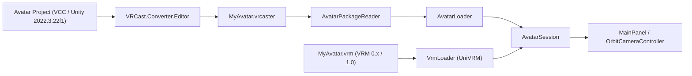
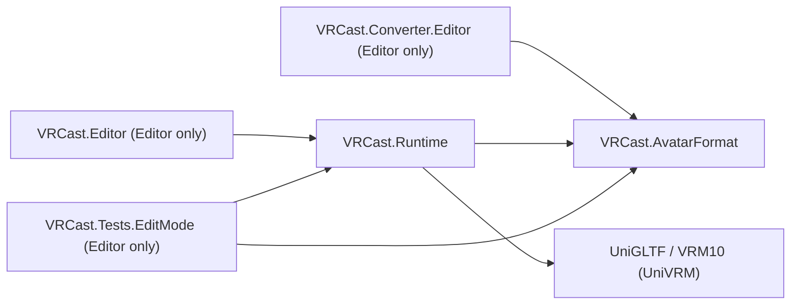

# Architecture

## 基本方針

- VRChat 用 Unity プロジェクトを Runtime として動かすのではなく、**アバターを必要なデータへ変換し、専用 Runtime で動かす**。
- Unity Editor は開発時・変換時にのみ使用し、完成した `VRCast.exe` には不要。
- アバターは信頼できない入力として扱い、**アバター = データ** とする（任意コードを実行しない）。

優先順位: アバターの可搬性 > Runtime の独立性 > 軽量性 > 安定したレンダリング > トラッキング > OBS 出力 > 高度な機能 > UI。

## 技術選定

| 項目 | 選定 | 理由 |
| :--- | :--- | :--- |
| Unity（書き出し側） | 2022.3.22f1 | VRChat SDK と同一（アバターのプロジェクトで使う） |
| Unity（VRCast 本体） | 2022.3 LTS の最新版（2022.3.62f3 以降） | AssetBundle は同じ系列（2022.3）なら読める。Unity 6 などの別系列はシェーダーの互換が保証されないため使わない。スクリプトは IL2CPP（CPU 負荷を下げ、Mono のランタイムを同梱しない） |
| Render Pipeline | Built-in | lilToon / Poiyomi 等 VRChat 向けシェーダーが Built-in 前提 |
| UI | IMGUI (標準モジュール) | 追加パッケージ不要。UI 作り込みは後回し |
| 入力 | Input Manager (旧) | 追加パッケージ不要 |
| 設定・manifest | `JsonUtility` | 標準機能のみで完結 |
| パッケージ | `System.IO.Compression.ZipArchive`（無圧縮格納） | .NET Standard 2.1 標準。Deflate を使わず展開負荷と依存を抑える |

## 全体構成

## Assembly 構成

| Assembly | 場所 | プラットフォーム | 参照 |
| :--- | :--- | :--- | :--- |
| `VRCast.AvatarFormat` | `Packages/com.vrcast.converter/Runtime` | 全て | なし |
| `VRCast.Converter.Editor` | `Packages/com.vrcast.converter/Editor` | Editor のみ | `VRCast.AvatarFormat` |
| `VRCast.Runtime` | `VRCast/Assets/VRCast/Runtime` | 全て | `VRCast.AvatarFormat`, `UniGLTF`, `UniGLTF.Utils`, `VRM10` |
| `VRCast.Editor` | `VRCast/Assets/VRCast/Editor` | Editor のみ | `VRCast.Runtime` |
| `VRCast.Tests.EditMode` | `VRCast/Assets/VRCast/Tests/EditMode` | Editor のみ | `VRCast.Runtime`, `VRCast.AvatarFormat`, Test Framework |

### 依存ルール

- `VRCast.Runtime` と `VRCast.AvatarFormat` は `UnityEditor`、`AssetDatabase`、VRChat SDK、VCC に依存しない。
  `AssemblyIsolationTests` が参照アセンブリを検査する。
- Exporter と Runtime の共通定義（manifest、ファイル配置、許可コンポーネント、ハッシュ）は `VRCast.AvatarFormat` に置き、重複実装しない。
- VRChat SDK への依存は `VRCast.Converter.Editor` に限定する。現状はアセンブリ参照を持たず、リフレクションで型名・フィールド名から読む（SDK 無しでもコンパイル可能）。Runtime プロジェクトには VRChat SDK を導入しない。
- Runtime プロジェクトは `com.vrcast.converter` をローカルパス（`file:../../Packages/com.vrcast.converter`）で参照する。
- 新しい Package を追加する場合は、理由と Runtime への影響をこのドキュメントに追記する。
  - UniVRM（`com.vrmc.gltf` / `com.vrmc.vrm`、v0.131.3、MIT）: `.vrm`（0.x / 1.0）を変換なしで読み込むため Runtime が参照する。
    使うのは読み込み（`Vrm10.LoadPathAsync`）と MToon10 / UniUnlit シェーダーのみで、UniVRM の揺れもの・表情・視線の処理は
    読込直後に止めてコンポーネントごと除去し、VRCast の `PhysBoneSimulator` / `ExpressionController` 等で動かす。
    シェーダーはビルドで除かれないよう `VRCastBuild` が Always Included Shaders に追加する。
- 外部バイナリ: トラッキングは別プロセスのトラッカーを同梱して起動し、UDP（`127.0.0.1`）で受信する
  （推論で描画を止めない・トラッカーの異常終了が Runtime に波及しない）。どちらもリポジトリには含めずビルド前に配置する。
  - 既定: MediaPipe トラッカー（`Tools/MediaPipeTracker/vrcast_tracker.py`、MediaPipe は Apache-2.0）を PyInstaller で exe 化し、
    モデルと一緒に `VRCast/Trackers/MediaPipeTracker/` へ（ビルド後に `StreamingAssets/` へコピー）（`Tools/MediaPipeTracker/build.ps1`、ダブルクリック用 `build.bat`）。顔・腕・手を JSON で送る（頭・腕・手・可視度は送信前に One Euro フィルターで平滑化）。MediaPipe の `cheekPuff` はほぼ 0 のため、頬の下側の輪郭の幅 / 両目の外側の幅の比が真顔の基準（狭まる側へ速く・広がる側へ遅く追う）からどれだけ広がったか（割合）を `cheekWiden` フィールドで送る（頬のふくらみへの変換・しきい値は VRCast 側の設定。`STATS` 行に広がりの最大を出す）。`--face-image <画像>` は画像 1 枚の顔の 478 点を `FACE_POINTS: {"face":…,"points":[…]}` の 1 行で出して終了する（パーフェクトシンク化の目印の自動配置用）
  - 代替: OpenSeeFace（BSD-2-Clause）を `VRCast/Trackers/OpenSeeFace/` へ（顔のみ、ビルド後に `StreamingAssets/` へコピー）
  - トラッカーは `Assets/` の外に置く（DLL 群が Unity のネイティブプラグインとして登録され、エディターのスクリプトコンパイルが失敗するため）
  - Unity 2022.3 では Unity 公式の推論パッケージ（Sentis）が使えず、MediaPipe の Unity プラグインは巨大なネイティブ依存になるため、
    Runtime へは組み込まない

### 名前空間

Unity の型名との衝突を避けるため、フォルダ・名前空間は複数形または別名にする
（`VRCast.Avatars`、`VRCast.Cameras`、`VRCast.Animations`、`VRCast.Dynamics`）。`VRCast.Avatar` / `VRCast.Camera` / `VRCast.Animation` / `VRCast.Physics` は
`UnityEngine.Avatar` / `UnityEngine.Camera` / `UnityEngine.Animation` / `UnityEngine.Physics` を隠すため使用しない。

## Runtime フォルダ構成

必要になった Milestone でフォルダを追加する（空フォルダは作らない）。

| フォルダ | 責務 | 追加時期 |
| :--- | :--- | :--- |
| `Core/` | ログ、設定、起動処理 | Milestone 0 (済) |
| `App/` | 起動時の各機能の生成と結線 | Milestone 1 (済) |
| `Avatars/` | `.vrcaster` 検証・展開・読込・生成、`.vrm` の読込と metadata への変換 | Milestone 1 (済) |
| `Cameras/` | カメラ操作 | Milestone 1 (済) |
| `UI/` | IMGUI 操作パネル | Milestone 1 (済) |
| `Rendering/` | 背景透過、解像度、ライティング | Milestone 2 (済) |
| `Animations/` | 待機ポーズ、表情（BlendShape）、まばたき、リップシンク | Milestone 3 (済) |
| `Audio/` | マイク入力（音量） | Milestone 3 (済) |
| `Dynamics/` | PhysBone 相当（揺れもの）、Constraint | Milestone 4 / 7 (済) |
| `Tracking/` | Tracking Provider と Driver（顔・腕・手） | Milestone 5 (済) |
| `PerfectSync/` | パーフェクトシンク化（目印・顔の座標系・形状の生成・既存 BlendShape の割り当て・別名保存・読込時の適用） | パーフェクトシンク化 (済) |
| `OSC/` | OSC 入出力 | Milestone 6 |
| `Output/` | 仮想カメラ出力（UnityCapture） | Milestone 8 (仮想カメラ済) |
| `Platform/` | OS 機能（ウィンドウへのファイルのドロップ、ファイル選択ダイアログ。Win32 P/Invoke） | 操作パネルの刷新 (済) |

## Core

| クラス | 責務 |
| :--- | :--- |
| `VRCastLog` | `Debug.Log` をカテゴリ付きで薄くラップ |
| `LogBuffer` | Debug log タブ用に、`Application.logMessageReceivedThreaded`（`SubsystemRegistration` で登録）で全スレッドのログを最大 2000 件の環状バッファに保持。`[VRCast][Category]` はカテゴリと本文に分け、それ以外は `Unity` カテゴリ。スタックトレースはエラーのみ保持。`Add` で Player.log に書かないログ（トラッカーの出力 `TrackerOutput`）も追加できる。`Version` で UI が変化を検出。重要度は DEBUG / INFO / WARN / ERROR で、DEBUG は `DetailEnabled`（設定 `detailedLogging`）の間だけ記録（`VRCastLog.Detail`）。直前と同じ内容は 1 件にまとめて `Count` を増やす。配布版では通常ログ・警告のスタックトレース取得を止める |
| `AppSettings` | 永続化する設定値（ウィンドウサイズ、最後に開いたアバター、背景透過・背景色（既定ベージュ）、仮想カメラの ON/OFF と方式（Windows 11 の Media Foundation を使うか）、ライト強度・向き・色温度・環境光・アバターの明るさ・輪郭線の太さ、待機ポーズの度合い、待機モーション（呼吸・体の揺れ・頭のゆらぎの ON/OFF・強さ・速さ）、自動まばたき・表情中のまばたき停止、揺れもの ON/OFF、リップシンク・マイク設定・母音の口の形と声の高さ補正・表情中の口の停止（マイク・トラッキング別）、トラッキングの ON/OFF・入力元（MediaPipe / OpenSeeFace）・ポート・鏡像・顔の左右の入れ替え（`FaceMirror` = 鏡像 XOR 入れ替え。まばたき・パーフェクトシンク・視線だけに使う）・体の動かし方と強さ・視線の強さ・まばたきのトラッキングの ON/OFF・腕と手の ON/OFF・肩による上半身の向きの ON/OFF とひねりの固定・トラッカーのパス・カメラ名、表示言語・UI の大きさ・パネルの背景の不透明度（20〜100%）・ダークモード・軽量モード・動作状況の表示・MediaPipe のトラッカーの動作（`TrackerMode`）・プロセスの優先度・X3D でキャッシュの無い側のコアで動かすか・P コア / E コアの選択（`HybridCoreSelection`）・描画に使う GPU（優先設定と直接指定の GPU 名）・アップデート確認の ON/OFF）。`ResetToDefaults` で同じインスタンスのまま既定値へ戻す（ウィンドウサイズ・最後のアバターは保持） |
| `UiLanguage` | 操作パネルの表示言語（Auto = 0: OS に合わせる / English = 1 / Japanese = 2 / Korean = 3 / ChineseSimplified = 4 / ChineseTraditional = 5、設定に数値で保存するため並びは変えない） |
| `TrackingSource` / `TrackingSourceInfo` | トラッキングの入力元（MediaPipe = 0 / OpenSeeFace = 1 / Vmc = 2 / IFacialMocap = 3 / MediaPipeVmc = 4 / MediaPipeIFacialMocap = 5、設定に数値で保存するため並びは変えない）と入力元ごとの判定。併用（4・5）は顔を外部アプリ（`NetworkSourceOf`）、腕・手と顔の代わりを同梱の MediaPipe（`BundledTrackerOf`）から受け取る。`IsBundledTracker` は同梱版を持つもの（ビルドでのコピー対象）、`UsesBundledTracker` は同梱トラッカーを起動するもの（併用を含む）。VMC の全身（`HasFullBody`）は併用では使わない |
| `BlinkShapeOverride` / `BlendShapeRef` | アバターごとのまばたきに使う BlendShape の指定（ON/OFF・両目・左目・右目。メッシュのパス + 名前）。`AvatarEntry.blinkShapes` に保存し、`AppSettings.GetBlinkShapes` / `SetBlinkShapes`（記録の無いアバターは対象外）で読み書きする |
| `BodyMotion` | 頭の位置に合わせた体の動かし方（Lean = 0: 足を固定して背骨・胸を傾ける / Move = 1: 腰ごと移動 / LeanAndMove = 2、設定に数値で保存） |
| `SettingsStore` | `settings.json` の読込・保存。破損時は既定値にフォールバック |
| `AtomicFile` | 一時ファイルに書いてから置き換える書き込み（`settings.json`・設定プリセットで共用） |
| `SettingsPreset` | 設定プリセット（`.yaml`（推奨）/ `.json`。`.yml` と以前の版の `.vrcastpreset` も読み込みだけ受け付ける。YAML は JSON と同じ構造で、読み込みは中身が `{` で始まれば JSON、それ以外は `SimpleYaml` で JSON に直してから同じ処理）の書き出し・解析・適用。`AppSettings` のフィールドをカテゴリ（`PresetCategory`。アバター関連の印付き）か除外のどちらかに必ず割り当てる（テストで検査）。ファイルはカテゴリごとのブロックに分けた JSON テキスト。知らないカテゴリ・キーは無視、無いキーは今の値のまま、カテゴリに属さないキーは反映しない。`formatVersion` は互換性のない変更時だけ上げる。中身を全部消したカテゴリ（YAML で値が null）は入っていない扱い |
| `SimpleYaml` | 設定プリセット・まばたきの `.anim`（`BlinkAnimation`）向けの YAML ⇔ JSON 変換。書き出しはブロック形式（字下げ 2、配列は `- `、文字列は数値・予約語・記号を含むときだけ JSON と同じ書式の二重引用符）。読み込みはブロック形式のマッピング・シーケンス、1 行の `[ ]` / `{ }`、引用符の有無を問わない文字列、`#` のコメントに対応し、アンカー・タグ・`|` `>`・字下げのタブは壊れたものとして false |
| `JsonObjectText` | JSON オブジェクトの一番外側のキーと値（JSON のテキストのまま）の切り分け・結合（`JsonUtility` で一部のキーだけを扱うため）。配列の要素の切り分け（`TryParseArray`、`SimpleYaml` の書き出しで使用） |
| `VersionUtility` | "1.2.0" 形式（先頭の v 可、欠けた桁は 0）のバージョン番号の解析と比較。読めない番号は「新しくない」扱い |
| `AppBootstrap` | `RuntimeInitializeOnLoadMethod` で起動時に設定を読み込み（初回は既定値で作成）、終了時にウィンドウサイズを含めて保存する |

## App / Avatars / Animations / Audio / Cameras / Rendering / Output / UI

| クラス | 責務 |
| :--- | :--- |
| `AppRoot` | シーン読込後に `AvatarSession` / `OrbitCameraController` / `RenderingController` / `ProcessTuner` / `VirtualCameraOutput` / `SpoutOutput` / `MicrophoneInput` / `TrackingReceiver` / `TrackingSkeletonView` / `TrackerProcess` / `FileDropReceiver` / `RemoteControl` / `MainPanel` を生成して結線。読込完了時にアバターへ `PoseController` / `BlendShapeLimiter` / `ExpressionController` / `BlinkController` / `LipSyncController` / `FaceTrackingDriver` / `HandTrackingDriver` / `IdleMotionController` / `PropAnimationPlayer` / `ConstraintSolver` / `PhysBoneSimulator` を付与。起動引数 `--avatar` または前回のアバターを自動読込。Windows ビルドではウィンドウのタイトルを「VRCast バージョン」に変更（`productName` は保存先フォルダに使われるため変えない） |
| `AvatarPackageReader` | `.vrcaster` の構造・サイズ・manifest・ハッシュを検証し、bundle を `temporaryCachePath/avatars/<sha256>/` に展開。`metadata/*.json`（expressions / descriptor / physbones / constraints）を読み込み（不正なら空） |
| `AvatarLoader` | bundle を非同期読込してアバターを生成し、許可リスト外コンポーネントを除去 |
| `VrmLoader` | `.vrm` をサイズ確認（`AvatarPackageReader.MaxPackageBytes` まで）後に UniVRM（`Vrm10.LoadPathAsync`、0.x は 1.0 へ変換）で非同期読込。`Vrm10Instance` を止めて表情・まばたき・口の形・SpringBone を `VrmAvatarData` へ写し、初期姿勢へ戻してから `RuntimeGltfInstance`（メッシュ・テクスチャ・マテリアルの所有者。破棄時に解放）以外の許可リスト外コンポーネントを除去 |
| `VrmAvatarData` / `VrmAvatarInfo` | VRM から変換した metadata（`ExpressionSet` / `AvatarDescriptorData` / `PhysBoneSet`）と表示用の情報（名前・VRM の版・作者）、UniVRM に依存しない変換前の中間データ（表情の BlendShape、SpringBone の関節・コライダー） |
| `VrmMetadataBuilder` | 中間データから metadata を作る（UniVRM 非依存でテスト可能）。表情は重み ×100・BlendShape の無い表情は除外・同名は番号付け。まばたきは最も多く使うメッシュ（両目が無ければ左右）、口は aa / ih / ou / ee / oh を Viseme の あ・い・う・え・お へ。SpringBone は直接の子で続く関節を 1 本の PhysBone にし（他の子は ignore）、stiffness・dragForce・gravityPower・hitRadius を pull・spring・gravity・radius へ換算（関節ごとに違えばカーブ）、カプセル・平面コライダーも変換 |
| `TransformPath` | アバタールートからの相対パス |
| `LoadedAvatar` | 生成済みアバターと bundle の組（VRM は bundle 無し、`Vrm` に VRM の情報）。`Dispose` で両方解放。フレーミング用境界（Humanoid は骨格基準、それ以外は Renderer 基準） |
| `AvatarSession` | 表示中アバター 1 体の Load / Reload / Unload と状態（読込中・エラー）。拡張子で `.vrcaster`（`AvatarPackageReader` → `AvatarLoader`）と `.vrm`（`VrmLoader`）を振り分け |
| `OrbitCameraController` | 注視点中心の回転・パン・ズーム、境界の高さ・幅が収まる距離へのフレーミング、FOV。視点（`CameraPose`: 注視点・距離・向き・画角・画角による拡大の倍率 `zoom`）の取得と適用（`Pose` / `SetPose`。Reset の戻り先は変えない）。`ZoomInsteadOfEntering`（設定 `cameraZoomInsteadOfEntering`、既定 ON）の間は、注視点からフレーミング時の境界の高さ × 0.25 の距離より近づけず、ホイールで近づき切った分を画角の拡大（最大 10 倍、`tan(画角/2)/倍率`）に回す。離れるときは先に拡大を戻す。旧版の記録（`zoom` = 0）は拡大なし。近くの描画が切れる距離は 0.02 m |
| `CameraPose` / `AvatarLook` / `AvatarEntry` / `BlendShapeLimit` | アバターごとのカメラの視点と見た目（ライト・アバターの明るさ・輪郭線の太さ・待機ポーズ・体の向き。輪郭線の太さは以前の版の記録に無いため `hasOutlineWidth` が false なら 1 として戻す）、入れた日時（`addedAt`、UNIX 秒、0 = 不明）、BlendShape の上限（上限を付けたものだけ、パス + 名前 + 最大値）。`AppSettings.avatarCameras`（以前の設定ファイルとの互換のため名前据え置き）に `.vrcaster` のパス（大文字・小文字を区別しない）をキーとして保存し、使うたびに末尾へ移して最近使った 50 体分まで保持。新しい順の先頭 10 件を Avatar タブの「最近使ったアバター」に表示（× → タイル内の確認で「外す」を押すと記録ごと削除）。`AppRoot` がアバター読込時に、見た目 → 画角 → フレーミング → 保存済みの視点の順に戻し、以降は変わったときだけ記録（読込中・アンロード後は記録しない）。見た目が未記録のアバターは読込時の設定をそのまま使う。全設定のリセットでは消さない |
| `RenderingController` | 描画のフレームレート（VSync を止めて上限を明示。通常 60fps / 軽量モード 30fps）、ダークモードの切り替え（背景色が切り替え前のテーマの既定色のときだけ新しいテーマの既定色へ）、背景（非透過 = 背景色、透過 = 背景色 + alpha 0。ウィンドウ表示は alpha を無視し、ゲームキャプチャは alpha で抜くため OBS には映らない）、パネルを隠している間は設定に関係なく透過（`ForceTransparent`、保存しない）、ウィンドウ解像度、太陽光（ディレクショナルライトの強さ・色温度・向き。向きはカメラ正面基準）、環境光（ライティングデータを焼かないため `RenderSettings` の単色環境光と SH を直接設定）、ライティングのプリセット（`LightingPreset`）、アバターの明るさと輪郭線の太さ（`AvatarMaterials` 経由）を設定値に従って適用 |
| `AvatarMaterials` | 表示中アバターのマテリアルの主色（`_Color` / `_BaseColor`）に Linear で倍率を掛ける（lilToon 等の明るさ上限を超えて明るくする）。輪郭線の太さ（`_OutlineWidth` = lilToon / MToon、`_LineWidth` = Poiyomi、`_Outline_Width` = UTS。元の値が 0 より大きいものだけ登録）にも倍率を掛ける（`HasOutline` で対象の有無を返す）。読み込み時にシェーダーごとのマテリアル数と lilToon の明るさ関連の値をログに出す |
| `VirtualCameraOutput` | メインカメラの描画結果（操作パネルは含まない）を仮想カメラへ送る。方式は `UnityCapturePlugin.dll` 経由の「VRCast Camera」（DirectShow）と、設定 `virtualCameraMediaFoundation`（Windows 11 以降のみ有効）で選ぶ `MediaFoundationCamera` の「VRCast Camera (MF)」。方式が変わったら（切り替え・全設定のリセット）前の方式を閉じて開始からやり直す。Media Foundation 版の作成に失敗したら 5 秒ごとに作り直す（ドライバーを登録すると始まる）。ドライバーの登録・解除（`RunDriverAsync`）は使用中の方式に振り分け、Media Foundation 版は自分のカメラを消してから行う。無効時はコンポーネントごと止めて描画コストを増やさない。送信結果を状態（`VirtualCameraState`: 停止・開始中・送信中・受け取る側待ち・エラー）と英語の説明に変換し、エラーのみログ |
| `MediaFoundationCamera` | Windows 11 の Media Foundation 仮想カメラ（`Tools/VirtualCamera` でビルドする `VRCastVirtualCamera.dll`）への送信。`MFCreateVirtualCamera`（セッション単位・現在のユーザー）でカメラを作り、描画結果を 1920x1080 の BGRA32（sRGB）へ写して 30fps まで `AsyncGPUReadback` で読み戻し、DLL 経由で共有メモリへ書く。DLL の有無・対応 OS・DLL のパス（登録時のコピー元）は初回だけ調べる |
| `VRCastVirtualCamera.dll`（C++、`Tools/VirtualCamera/src`） | Frame Server が読み込むメディアソース（`Activator` → `MediaSource` → `MediaStream` 1 本、NV12 / RGB32 の 1080p・720p、30fps）と、VRCast から呼ぶ関数（`VRCastVCam_Start` / `Stop` / `Send` / `IsSupported` / `GetModulePath`）。共有メモリ（`Global\VRCastVirtualCameraFrame`、作れなければ `Local\`）はストリーム開始時にサービス側が作り、対話ユーザーにも書き込みを許す。送る側は受け取る側が 3 秒読まなければ閉じ、受け取る側は送る側が 3 秒書かなければ黒を出す |
| `SpoutOutput` | メインカメラの描画結果を Spout2 の送信元「VRCast」として共有する（OBS の Spout2 Capture 等で受信）。KlakSpout（Unlicense）のネイティブプラグイン `KlakSpout.dll` を直接呼び（`CreateSender` と描画イベント `UpdateSender` / `CloseSender`）、C# 側のパッケージは使わない。描画結果を同じ大きさの ARGB32 テクスチャへ上下反転して写して送る（Spout2 の受信側は上の行から読むため。大きさが変わったら送信元を作り直す）。アルファはカメラの背景設定（透過）に従う。イベントデータはネイティブメモリに置き、閉じた後は数フレーム待ってから解放。Direct3D 11 / 12 以外・DLL 無しは状態表示とログを出して停止 |
| `VirtualCameraInstaller` | 同梱ドライバー（`StreamingAssets/UnityCapture` の 32 / 64 bit フィルター）の検出、レジストリ（64 bit フィルターの CLSID）からの登録状態の判定、`regsvr32` の管理者実行による登録（デバイス名指定）・解除。Media Foundation 版は `VRCastVirtualCamera.dll` を `Program Files\VRCast\VirtualCamera` へコピーして登録（Frame Server のサービスはユーザーのフォルダを読めない）、解除は登録を外してコピーを削除。使用中で上書き・削除できないときだけ Frame Server を止めてやり直す。どちらも終了コードに加えてレジストリで結果を確かめる |
| `PoseController` | アバターの向き（Body yaw）と、Humanoid の待機ポーズ。読込時姿勢の筋肉値から肘の曲げだけを補間し、腕は上腕ボーンを真下（外側へ 12°）へ向けて回す。既定は気を付け（0 / 0 で元の姿勢を復元）。`Reapply` で設定値から反映し直す |
| `IdleMotionController` | 待機モーション（呼吸・体の揺れ・頭のゆらぎ、既定 ON）。Humanoid の背骨・胸・上胸・肩・首・頭をアバタールート基準で少しだけ回して上乗せ（揺れ・ひねりは上半身で等分、呼吸は胸の反りと肩の上げ、上半身の傾きの 6 割を首で打ち消す）。前フレームの上乗せは、ボーンが書いたままなら外し、他（待機ポーズの変更・トラッキング）が書き直していればその回転を新しい基準にする。ON/OFF と顔のトラッキングの開始・終了は 0.5 秒で出し入れし（トラッキング中は頭のゆらぎを止める）、止まり切った後はボーンを触らない。`Suspended` の間は OFF と同じく止める（パーフェクトシンク化の編集中）。実行順 -95（`FaceTrackingDriver` の後、`HandTrackingDriver`・Constraint・揺れものの前） |
| `AvatarParticles` | アバターの ParticleSystem をまとまりごとに ON/OFF する。まとまりは、`metadata/particle_groups.json`（FX で `m_IsActive` を動かすオブジェクトのうちパーティクルを含むもの）のうちパーティクルに最も近い祖先（自身を含む）。該当が無ければ、親がルート・ボーン（SkinnedMeshRenderer のボーンと Humanoid のボーン）でなく、子孫にボーン・FX の単位・パーティクル以外の Renderer を含まない（エフェクトのフォルダー）間だけ親へたどる。同じ単位のものは 1 つにまとめる。初期状態は読込時の表示（FX の初期状態、1 つでも表示中なら ON）、記録（`AvatarEntry.particles`、パス単位で ON/OFF と利用者が付けた名前 `name`、空なら Unity 上の名前、64 文字まで）があれば当てる。OFF は各パーティクルの `StopEmittingAndClear` と ParticleSystemRenderer の無効化（オブジェクトは隠さない）、ON は各パーティクルのアバタールートまでの非表示の親を表示して描画を戻し `Play(false)` |
| `AvatarObjects` | アバターの階層（ルート自身を除く子孫）を深さ優先の行（パス・名前・深さ・親と子孫の範囲・子孫に Renderer があるか・`metadata/fx_toggles.json` に載っているか・読込時の `activeSelf`）にし、行ごとに `SetActive` する。読込時の状態と違うものだけを記録（`AvatarEntry.objects`、パス単位で ON/OFF）し、読込時に当て直す（同じパスが複数あれば先頭。見つからないパスは無視）。`ResetAll` は記録したものだけを読込時の状態へ戻す（パーティクルの ON で表示した親などは触らない）。`AvatarParticles` より先に初期化し、記録済みのパーティクルの ON が非表示の親を表示できるようにする |
| `IdleMotion` | 待機モーションの角度を時刻と強さから求める状態の無い計算（呼吸 4.5 秒で吸う 4 割・吐く 6 割、揺れ 9 秒 + 小さい波、ひねり 13 秒、頭は Perlin ノイズ。強さ 1 で 1〜2 度） |
| `ExpressionController` | 表情プリセットを BlendShape に適用。切替時は前の表情から次の表情へ 0.2 秒かけてモーフィング（プリセットに無い BlendShape は読込時の値へ。変化中のフレームだけ書き込むので、まばたき・口パクの上乗せと両立）。表情ごとのショートカットキー（`KeyCombo`。ニュートラル含む、既定は未割り当て、1 組み合わせ 1 表情、押した瞬間だけ反応。押下判定は `HotkeyPoller`）。`TryFindHotkey` でリセットのショートカットキーとの競合を調べられる。手動の選択（ボタン・キー・外部操作）は `Select` で固定（`IsManual`）し、トラッキングの自動検出で上書きしない。`toggle` 付きで固定中の同じ表情を選ぶか `ReleaseManual` / `ResetToNeutral` で固定を外す |
| `ExpressionMapping` | 検出した表情（笑顔・驚き・怒り・悲しみ・ウインク・ジト目・ふくれっ面）→ 表情プリセットの対応付け。設定に保存したプリセット名（空欄 = 自動、`<none>` = 割り当てなし）で解決し、無ければプリセット名のキーワードで推定。割り当て先がある表情のビット列（`Candidates`）も求める。表情ごとのしきい値の読み書き（未設定なら共通の `trackingExpressionThreshold`） |
| `BlendShapeOverlay` | BlendShape の検索と、元の値（表情等）を保ったままの上乗せ書き込み（`BlendShapeLimiter` の上限で切って書き、上限で切った固定の値は切る前の値を元の値として読む） |
| `BlendShapeLimiter` | アバターごとの BlendShape の上限。読込時に全 `SkinnedMeshRenderer` の BlendShape を列挙し、記録済みの上限（パス + 名前）を当てる。表情・まばたき等より先に初期化し、`BlendShapeOverlay` の生成（まばたき・口パク・パーフェクトシンク）と `ExpressionController` の対象解決が `MarkFace` で「顔」として登録する（一覧の区分だけで、上限の効き方は同じ）。`BlendShapeOverlay` と `ExpressionController` は書き込む前に `Limit` を通す。`SetExempt` で上限をかけない BlendShape にでき（`Limit` と LateUpdate の切り詰めを飛ばす）、`ExpressionController` が表情反映の表情（`Apply(preset, tracked: true)`。ニュートラルへ戻り切るまで）の間、設定 `trackingExpressionsIgnoreLimits` に従って切り替える。`BlendShapeOverlay` は元の値に `Limit`、上乗せ分に `LimitAlways`（対象外でも切る）を使う。どの処理も書かない固定の値は LateUpdate の最後（実行順 10000）に上限で切り、上限を緩めると切る前の値へ戻す。表示中のアバターの分だけを静的に参照する |
| `BlendShapeSync` | MA Blendshape Sync の再現（`metadata/blendshape_sync.json` があるアバターだけに付ける）。実行順 9000（まばたき・口パク・トラッキング・表情の書き込みの後、`BlendShapeLimiter` の前）に同期元の値を同期先へ写す（同期先の `Limit` を通し、変わったときだけ書く） |
| `BlinkAnimation` | まばたきの `.anim`（Unity のテキスト形式の AnimationClip）の読み取り。`%` / `---` の見出しを除き、`Infinity` / `NaN` を数値に置き換えて `SimpleYaml` で JSON にし、`JsonUtility` で `m_FloatCurves`（無ければ `m_EditorCurves`）の SkinnedMeshRenderer（classID 137）の `blendShape.*` のカーブだけを `AnimationCurve` にする（無限大の傾きは戻す）。長さ 0 のクリップは閉じた形として `BlinkController.Evaluate` の閉じ具合を掛ける。バイナリ形式（先頭に NUL）は読まない。読み込みは `AppRoot`（アバター読込時、`AppSettings.GetBlinkAnimation`）と `BlinkAnimationControls` |
| `BlinkController` | ランダム間隔の自動まばたき（ON/OFF 可。閉じる・閉じたまま・開く時間と間隔の範囲は `AppSettings.blink*`、閉じ具合の時間変化は `Evaluate`、`BlinkNow` で設定を試す 1 回。`SetAnimation` で `BlinkAnimation` を渡すと自動まばたきはまぶたの BlendShape を開いたままにしてその BlendShape のカーブを再生し、まぶたと同じ BlendShape は同じ上乗せを共用して大きい方を書く）。外部入力（トラッキング、左右別）があればそちらを優先。設定により表情（`ExpressionController.Current`）中はどちらも止める。止めていた後（表情・外部入力・OFF）は再開時点から次のまばたきを予約し直す（止めている間に過ぎた予定ですぐ閉じない）。両目用とウインク用 BlendShape の振り分け。アバターごとの指定（`BlinkShapeOverride`、ON のとき）があればまぶた設定・名前からの推定の代わりにそれを使う（ウインク用は左右両方があるときだけ）。`Rebuild` で開いた状態へ戻してから作り直し、`DescribeAutomatic` で今の自動の割り当てを返す。`Suspended` の間はどちらも止めて開いたまま（パーフェクトシンク化の編集中） |
| `LipSyncController` | マイク音量 × 母音の重みを Viseme `aa` / `ih` / `ou` / `E` / `oh`（同じメッシュの同名の BlendShape はまとめる、無い母音は `aa` で代用）へ、JawFlap 方式は口開閉 BlendShape へ、`visemeAnimation` 方式は Viseme ごとの BlendShape の組（複数メッシュ可）へその重みを掛けて上乗せ。外部入力（トラッキングの口の開き）はマイク音量と大きい方を開き具合に使い、声が出ている間はマイクの母音で配る（無音なら `aa`）。設定により表情（`ExpressionController.Current`）中はマイク分・外部入力分をそれぞれ止める。`Suspended` の間は両方止める（パーフェクトシンク化の編集中） |
| `MicrophoneInput` | マイクのループ録音と音量（RMS、ゲート・感度・平滑化）、声が出ている間の母音推定（`VowelAnalyzer`）と重みの平滑化。デバイス切替・切断時の再開 |
| `VowelAnalyzer` | 約 11kHz へ間引き → 高域強調・ハミング窓 → LPC（12 次、Levinson-Durbin）の包絡から F1 / F2 を求め、母音（あいうえお）の代表値との対数周波数の距離で重み（合計 1）を出す。声の高さ補正は代表値に掛ける倍率 |
| `PhysBoneSimulator` | アバターの全 PhysBone を 60Hz 固定ステップで更新。ON/OFF、粒子数上限。`Suspended` の間は設定に関係なく静止姿勢で止める（パーフェクトシンク化の編集中） |
| `PhysBoneChain` | 1 PhysBone の Verlet 近似（pull / spring / stiffness / gravity / immobile / 角度制限 / 長さ拘束）と Transform への回転反映。前のフレームの最後に書いた回転と違っていれば（小物のアニメーション・Constraint が書き換えた）、その回転と今の位置を新しい静止姿勢にする（動いた姿勢に揺れを重ねる） |
| `PropAnimationPlayer` | 小物のアニメーションの自動再生（設定 `propAnimationsEnabled`、既定 ON）。小物の Animator（コントローラー付き、ルート以外）・小物の Animation（`playAutomatically` のもの）と、ルートの Animation の `AvatarPackageLayout.FxMotionClipPrefix` のクリップ（FX の初期状態の動き。名前の番号順 = FX のレイヤー順に上のレイヤーへ置き、全部を同時に再生）。OFF では Animator は `Rebind` + `Update(0)`、Animation は時刻 0 を `Sample` してから止める。Animator・Animation の評価は `Update` の後なので、Constraint・揺れもの（LateUpdate）は動いた後の姿勢に重なる |
| `PhysBoneCollider` | 球・カプセル・平面コライダーによるボーン線分（半径付き）の押し出し |
| `ConstraintSolver` | アバターの全 Constraint をトラッキング適用後・揺れもの計算前（実行順 -50）に毎フレーム評価。評価器の作成と並べ替えは `ConstraintEvaluator.CreateAll` |
| `ConstraintEvaluator` | （Converter の Runtime。アプリとエクスポーターのプレビューで共有）1 Constraint（Position / Rotation / Scale / Parent / Aim / LookAt）の評価。重み付き平均・オフセット・静止値・軸マスク・ローカル空間。`CreateAll` で全 Constraint を参照関係の順に並べて作る（Humanoid ボーンと腰の親（Armature 等）を動かすものは対象外） |
| `IFaceTrackingProvider` / `FaceTrackingFrame` | フェイストラッキング入力元の共通インターフェースと 1 フレーム分の値（表情の強さ `ExpressionScores` は MediaPipe のみ） |
| `ExpressionCalibration` | 表情のキャリブレーションの計算と記録の出し入れ。入力元・表情（0 = 真顔）ごとの `ExpressionCalibrationSample`（ARKit 互換の値 51 種の平均。`AppSettings.expressionCalibrations`、設定プリセットからは除外）を引き、`Apply` で登録のある表情の強さだけを `Score` に置き換える（真顔が無い入力元はそのまま）。`Score` は `eyeLook*` を除いた値で、真顔からの差を表情の向きへ射影した進み具合 p（0〜1）と、向きから外れた距離の比 r から p / (1 + r²)。ウインクは左右を入れ替えた顔とも比べる。差の二乗和が `MinSeparation` 未満の記録は使わない。`FaceTrackingDriver.ApplyExpression` と Raw view が使う |
| `ExpressionCalibrationRecorder` | 表情のキャリブレーションの記録係（準備 3 秒 → 顔を受け取っている間だけ 2 秒・10 フレーム以上の平均を記録、複数の表情を順に）。真顔と区別できない表情は登録せず `NotDistinct` に残す。入力元が変わったら中止。`IFaceTrackingProvider.TryGetFrame` を読むだけ（消費しない）なので、アバターが無くても記録できる。`ExpressionCalibrationControls`（トラッキングタブの登録 UI と、`MainPanel` が描く画面上中央の案内）が持ち、`MainPanel.Update` から毎フレーム進める |
| `ExpressionDetector` | 表情の強さから今の表情を 1 つに決める（割り当て先がある表情だけを候補にする、入る / 抜けるしきい値のヒステリシス、0.3 秒の保持、口を開けている間は笑顔のしきい値を上げる。入るしきい値は表情ごとの設定値（0.1〜3。強さは 0〜1 なので 1 より大きいと切り替わらない）、抜けるしきい値はその 0.65 倍） |
| `IBodyTrackingProvider` / `BodyTrackingFrame` / `ArmTrackingData` | 腕・手のトラッキング入力元の共通インターフェースと 1 フレーム分の値（本人の左右、肩・肘・手首と手の 21 点、カメラ基準の Unity 座標） |
| `OpenSeeFacePacket` | OpenSeeFace UDP パケット（1 顔 1785 バイト）の解析と座標変換 |
| `MediaPipePacket` | 同梱 MediaPipe トラッカーの JSON の解析（頭の変換行列・BlendShape 51 種 → 頭・目・口・視線・表情の強さ（笑顔 = 口角、怒り = 眉下げ、驚き = 眉全体の上げ、悲しみ = 口角下げ + 眉の内側だけの上げ、ウインク = 左右のまばたきの差、ジト目 = 両目の半閉じ（下向きの視線で弱める）、ふくれっ面 = mouthPucker）、トラッカーが顔の点の形から測った頬の幅の広がり（`cheekWiden` → `CheekWiden`。古いトラッカーは送らず 0）、腕 6 点と可視度、体の推定の顔の点（`head`: 鼻・左目・右目と可視度。両目の中点、隠れていれば鼻を `BodyTrackingFrame.Face` に。古いトラッカーは送らず `HasFace` = false）、左右の手 21 点）と座標変換 |
| `TrackingMath` | パケット解析共通の非有限値チェック、カメラ基準 → アバタールート基準の変換と回転の左右反転（Driver・確認表示で共通） |
| `TrackingSkeletonView` | Raw view: 受信値を VRCast 側で平滑化せず GL の線で描く確認表示（MediaPipe トラッカーが送信前に One Euro フィルターで平滑化した値）（腕・手の点、背骨（腰 → 肩の中点）と `TorsoPose` の上半身の向きの箱（ひねり固定を反映、アバターに使わない設定では灰色）、頭の向き、視線、目・口の開き）。表示中はカメラの cullingMask を 0 にしてアバターを映さず、アバターの腰の位置・向き・鏡像設定に合わせ、腰 → 頭のボーンの長さ ÷ 0.6 m の倍率で拡大・縮小して描く（非 Humanoid は実寸） |
| `TrackingReceiver` | 顔・腕手の Provider。受信口（`TrackingChannel`）を 2 つ持ち、通常は 1 つ、併用の入力元では外部アプリ用と MediaPipe 用の 2 つを動かす。併用では顔は外部アプリを優先し、途絶えている間は MediaPipe の顔を使う（`FaceSource` で今の顔の入力元を返し、`FaceTrackingDriver` は変わったら正面を取り直す）。腕手は MediaPipe 用から受け取る。併用をやめたときは MediaPipe 用を先に閉じてポートを空ける |
| `TrackingChannel` | UDP の受信口 1 つ（同梱トラッカーは `127.0.0.1`、外部アプリは全アドレス）。入力元に合わせて解析を切替。途絶検出・再 bind・受信 fps。診断ログ: 最初のパケットの送信元、途絶（3 秒）・待ち受けから 15 秒無受信の警告、不正パケットの原因推定（入力元の設定違い・プロトコル版の不一致。10 秒に 1 回）、詳細ログ ON 時は 5 秒ごとの受信統計と顔の検出 / 見失い（集計は整数の加算のみ） |
| `TrackerProcess` | 同梱（ビルドでは `StreamingAssets/`、エディターではプロジェクト直下の `Trackers/` の `MediaPipeTracker/` / `OpenSeeFace/`）または指定されたトラッカーの自動起動・再試行・停止、カメラ一覧（`-l 1`）の取得・解析、デバイス名 → 番号の解決。入力元・手の ON/OFF・トラッカーの動作（MediaPipe）・軽量モード（OpenSeeFace）の変更で再起動。MediaPipe 版へはトラッカーの動作（`TrackerMode`、`MediaPipeModeArgument`）に応じて「ぬるぬる」= `--hand-search-every 2`（顔・体・手を毎フレーム）、「なめらか」= `--pose-every 2 --hand-search-every 2`、「エコ」= `--max-fps 20 --pose-every 2 --hand-search-every 3` を、軽量モードでは OpenSeeFace へ `--model 2` を渡す。MediaPipe 版へは自分の PID（`--parent-pid`）を渡し、異常終了時もトラッカーを残さない。起動したトラッカーは `ProcessTuning` で Windows の電力調整（EcoQoS）から外し（VRCast が背面にある間に推定が遅れて手を見失わないように）、設定の優先度（`processPriority`）と使うコア（`CpuTopology.CoreMaskFor`）にする。どちらの変更も再起動せずに反映。診断ログ: 起動コマンドライン・PID、終了コードの意味（`DescribeExitCode`。知らない引数で止まったときは `IsOutdatedTracker` でトラッカーが古いと出す）と動作時間、一覧の取得時間、同じ警告は状態が変わったときだけ。出力行は `ClassifyOutput` で重要度へ振り分け（`STATS:` → DEBUG、`WARN:` / glog `W` → WARN、`ERROR:` / glog `E`/`F` / Traceback → ERROR）、INFO は毎秒 30 行までに制限し、超過分は件数を 5 秒ごとに警告。仮想カメラ・赤外線カメラらしい名前（`IsLikelyUnusableCamera`）は既定の選択で避け（`ChooseDefaultCamera`）、選ばれていれば起動時に警告 |
| `FaceTrackingDriver` | 頭の向きを首・頭ボーンへ、頭の位置を背骨・胸の傾き / 腰の移動（`BodyMotion` で切替）へ、両肩が映っていれば（`trackingTorso`・腕・手 ON）`TorsoPose` の肩の線のひねり（`trackingTorsoLockTwist` なら 0）・左右の傾きを背骨・胸へ（左右の傾きは頭の位置による傾きと 0.3 秒で切り替え、正面はキャリブレーション後の最初の肩の線、頭は首で打ち消して絶対の向きを保つ）、視線を目ボーンと `GazeBlendShapes`（「上を見る」等の両目まとめの BlendShape）へ、まばたき（左右別、`trackingEyeOpenOffset` までの閉じ具合は開いた目とみなす（パーフェクトシンクの eyeBlink と、`ArKitFace.AdjustExpression` で求め直すジト目・ウインクの判定も同様）、`trackingBlink` OFF なら渡さず自動まばたきへ）・口を `BlinkController` / `LipSyncController` へ適用。キャリブレーション・鏡像。表情反映（MediaPipe・設定 ON のみ）は `ExpressionDetector` の結果か割り当てが変わったときだけ `ExpressionController.Apply`（手動で固定中は当てず、固定が外れたら今の判定結果をすぐ当て直す）、無効化・途絶時は自動で当てた表情だけをニュートラルへ。`Suspended` の間は途絶と同じ扱い（正面は保持、カメラ目線も止める。パーフェクトシンク化の編集中・離席中）。`HoldInput` の間も途絶と同じだがカメラ目線は続ける（顔が見つからないあいだ）。パーフェクトシンク（MediaPipe・設定 ON・対応アバター）は `PerfectSyncBlendShapes` へ値を渡し、その間は表情反映を止め、ARKit 名で目・口を動かせるなら通常のまばたき（開いたままの外部入力）・カメラの口の開きを重ねない。パーフェクトシンクが `eyeLook*` を動かしている間は `GazeBlendShapes` を重ねない |
| `GazeBlendShapes` | 視線用の両目まとめ BlendShape（「上を見る」「下を見る」「右を見る」「左を見る」、LookUp 等）。`FaceTrackingDriver` が目ボーンと同じ視線角度で動かす。パーフェクトシンクが `eyeLook*` を動かしている間は重ねない。ARKit の片目用名は対象外 |
| `PerfectSyncBlendShapes` | パーフェクトシンク。アバター内の全 `SkinnedMeshRenderer` から ARKit 名（`MediaPipePacket.BlendShapeNames` の 51 種）の BlendShape を探し（大文字小文字・区切り記号・`blendShape1.` 等の接頭辞を無視、末尾 L / R も可）、20 種類以上あれば対応とみなす（`IsAvailableFor(anyShape)` で設定の「1 種類でも」にも対応）。受信値（左右は映像基準）を Mirror に合わせて左右を入れ替え、平滑化して `BlendShapeOverlay` で書く（eyeBlink は 0.15〜0.65 を 0〜1 へ広げる）。解除時は一度だけ元の値へ戻す。`Create` に `PerfectSyncBinding`（パーフェクトシンク化の既存 BlendShape の割り当て）を渡すと、その ARKit 名は割り当て先へ強さを掛けて書き、名前の照合より優先する。同じ BlendShape に複数の ARKit 名が当たる（両目まとめのまばたきに左右など）ときは、上乗せを 1 つにまとめて大きい方の値を毎フレーム 1 回だけ書く（別々の上乗せが互いの値を元の値として取り込み、値が下がらなくなるのを防ぐ）。`FaceTrackingDriver.RebuildPerfectSync` で編集中に作り直す。`Apply` に `PerfectSyncBoost` を渡すと、口・頬の値を強調してから平滑化する。`DrivesEyeLook` で視線用 BlendShape との二重駆動を避ける |
| `PerfectSyncBoost` | パーフェクトシンクの口・頬の強調（設定の「口・頬の動きを強調」、既定 ON）。検出が弱い ARKit 値を組ごとの倍率（1〜5）で強めて 0〜1 に収める: ふくれっ面 = `mouthPucker` / `mouthFunnel`、口の左右 = `mouthLeft` / `mouthRight`（受信値と、`EstimateMouthSides` で `FaceTrackingFrame.MouthShift` を 2〜8% で 0〜1 にし、`FaceTrackingDriver.MouthSideEstimates` で Mirror に合わせた推定値の大きい方。既定倍率 1）、頬 = `cheekPuff`（受信値と、`EstimateCheekPuff` で `FaceTrackingFrame.CheekWiden` を設定の出し始め〜最大（%）で 0〜1 にし、jawOpen・口角で弱めた推定値の大きい方）、唇 = `mouthRoll*` / `mouthShrug*` / `mouthPress*`。`default` は強調なし。`FaceTrackingDriver.CurrentBoost` が設定から作り、パーフェクトシンク中だけ効く（表情の判定に使う受信値は変えない） |
| `JawOpenAdjustment` | パーフェクトシンクの口の開き（`jawOpen`）の補正（設定の「口の開き」）。`Deadzone` までを 0 とみなして残りを 0〜1 に広げ、`Gain` 倍して 0〜1 に収める。`default` は補正なし（`Gain` 0 以下は 1 扱い）。`FaceTrackingDriver.CurrentJawOpenAdjustment` が設定から作り、`PerfectSyncBlendShapes.Apply` が `jawOpen` だけにかける（強調の ON/OFF とは無関係） |
| `PerfectSyncBoostControls` | 「口の開き」（`FaceTrackingDriver.JawOpenReceived` と補正後の今の値も出す）と「口・頬の動きを強調」の設定 UI（ON/OFF・組ごとの倍率・頬のふくらみの検出のしきい値と、`FaceTrackingDriver.CheekWiden` / `CheekPuffEstimate` / `MouthSideEstimates` の今の値）。トラッキングタブと、パーフェクトシンク化の「実際のトラッキングで試す」中に左側に出す調整パネルで共用。変えた値は同じ `AppSettings` ですぐ共有し、`Snapshot` は試し始めの控え。「設定を保存」（`AppBootstrap.Save`）でファイルへ書き、「元に戻す」で控えへ戻す |
| `FaceLandmarks` / `FaceMeshGeometry` | 目印の種類（`LandmarkId`、番号は保存するので固定）・細かさごとの並び・左右の対応 / 顔メッシュの頂点・法線・三角形（目印 = 三角形の番号と重心座標の位置、Möller–Trumbore の光線判定、最も近い表面の点、面での反転） |
| `FaceParts` / `FacePartRules` | アバターに無いことがある部位（眉・鼻・口の中。値は `absentParts` に保存）と、目印・ARKit の形状がどの部位のものか。`FaceLandmarks.For(detail, absent)` / `RequiredFor(absent)` で無い部位の目印を除く |
| `FaceRig` | 目印から顔の座標系（左 = 左右の組の差の平均、上 = あご → 眉（眉が無ければ両目の中心）、前 = 上 × 左を法線・鼻先で向きを確認、原点と大きさ = 両目の中心と間隔）を作り、打っていない目印を推定して補う（眉が無ければ目の上に置く）。左右対称の面の推定 |
| `LandmarkEstimator` | 目印の自動配置（BlendShape から）。BlendShape を 100 にした今の姿勢の頂点との差から、顔の局所座標（`FaceAxes`: 左・上・前）で推定する。顔のまわりの三角形を同じ位置の頂点でまとめ、三角形でつながる最も大きなまとまりを肌とし（まつ毛・眉・歯などの部品を除く。`Surface` に入れて目印を置く面にする）、肌の縁（三角形 1 つだけが使う辺。同じ位置でも形状での動き方が違う頂点は分けるので、閉じた唇・まぶたの線も縁になる）を求める。目: この側だけにあり、まばたきで大きく動く部分と動かない部分の差が最も大きい縁 → 左右の端 = 目頭・目尻、中央・途中の x で縁を横切る最も上と最も下 = 上下のまぶた。口: 顔の中央をまたぎ、「あ」で下側だけ下がる顔の前の面の近くの縁 → 左右の端 = 口角、中央・口角寄りの x の上下 = 唇。縁が無ければ、まばたきで最も動く頂点 = 上まぶた・その閉じた位置 = 下まぶた・動く範囲の端 = 目頭・目尻、「あ」で下がる前向きの中央の列の上端 = 下唇・すぐ上の動かない最も下 = 上唇、「う」で内側へ寄る頂点（無ければ「あ」で下がる部分の横の端）= 口角。あご = 「あ」で下がる中央の列の下端（下唇から奥へ両目の間隔の半分まで）、眉 = 眉の形状すべてで最も動く量が大きい部分（眉が別の部品ならその部品）の内外の端・中央の付近の平均、鼻先 = 目と口の間で最も前の肌。データの無い眉・あご・口角は比率で推定し `Guessed` に入れる |
| `ImageCorrection` | 目印の自動配置（BlendShape + 画像認識）。MediaPipe の点を BlendShape から求めた目印の画像上の位置に合わせる補正。最小二乗のアフィン変換（2 組なら相似、1 組なら平行移動）で全体のずれを直し、5 組以上なら残りのずれが中央値の 3 倍を超える組を除いて合わせ直す。残ったずれは目印の広がりの 0.35 倍を幅とするガウスの重みで近くの目印ほど強く足す |
| `MediaPipeFaceMap` | 目印の自動配置（画像認識）。トラッカーの `--face-image` の結果の行（`FACE_POINTS: `）の読み取りと、MediaPipe の 478 点の番号 → 目印の対応表（唇・眉は外側と内側の縁の中点）。MediaPipe の左右は本人基準なので、正面から写せばアバターの左右と一致する |
| `FaceRegions` / `FaceShapeMath` | 目（まぶたの輪郭の折れ線）・眉・口（唇の線・顎の範囲と回転）の領域と、なめらかな重みの計算 |
| `PerfectSyncGenerator` | `FaceRig` と領域から ARKit 51 種の頂点の移動量を作る（強さ 0 は作らない。歯・舌のメッシュは顎の形状だけ。顔の大きさの 1e-4 未満の移動は省く）。顔メッシュの三角形を渡すと、肌の外周（`FaceMeshSeams`。目・口の穴の縁と口の中は除く）から両目の間隔の 0.3 倍以内をなめらかに動かさなくし、首・頭など別のメッシュとの継ぎ目に隙間が開かないようにする |
| `FaceMeshSeams` | 顔メッシュの肌の外周。同じ位置の頂点（UV の継ぎ目）をまとめ、三角形でつながるまとまりのうち最も大きいもの（肌）の、1 つの三角形にしか使われない辺の頂点を返す（眉・まつ毛・歯など離れた部品は含めない） |
| `PerfectSyncAutoMapper` | 既存の BlendShape 名（Viseme・まばたき・笑顔・眉・ぷくー等。接頭辞・記号を除いて完全一致）から ARKit 名への割り当てを推定（eyeSquint は安静時も値が出るため、上まぶたを下げるジト目・なごみは当てない） |
| `PerfectSyncPackageWriter` | 元の `.vrcaster` の全エントリを複製（古いパーフェクトシンクのデータは除き、manifest の名前は保存名に）して `perfect_sync.json` / `perfect_sync_shapes.bin` を足し、一時ファイル経由で別名保存（元と同じパスは拒否）。既定の保存名は `元の名前_PerfectSync.vrcaster` |
| `PerfectSyncMeshes` | 保存した形状を、読めるメッシュの複製の末尾へ `AddBlendShapeFrame` で足してレンダラーを差し替える（既存の番号・値は保つ）。`Restore` で元へ戻して複製を破棄。`AvatarLoader` が読込時に適用し、`LoadedAvatar.Dispose` で破棄 |
| `TorsoPose` | 両肩（`ArmTrackingData.HasShoulder`）の線から上半身のひねり（縦軸まわり）・左右の傾き（前後軸まわり）を度で求める（鏡像は腕と同じ対応、肩幅 0.1 m 未満は求めない） |
| `ArmIk` | 腕の位置合わせの計算（状態なし）。手首と顔の距離（本人の m、35 → 15 cm）から顔基準の割合、顔の正面の手を顔から 6 cm 手前に出す補正（横・上へ外れるとなめらかに無効）。`KeepHandInFrontOfFace` はそれに加え、顔の楕円（横 11 cm・縦 13 cm）に重なる手の点も 6 cm 手前まで出す（顔の面より 12 cm より奥の点は頭の後ろとみなして動かさない）。肩・上腕と前腕の長さ・手首の目標・曲げる向きから余弦定理で肘の位置（届かない目標は伸ばした先へ）、肩→手首の線に垂直な肘の曲げの向き |
| `HandTrackingDriver` | 腕は設定 `trackingArmMatchAvatar`（既定 ON）なら、肩→肘・肩→手首・顔（`BodyTrackingFrame.Face`）→手首をなめらかにして、手首の目標 = アバターの上腕の付け根 + 肩→手首 ×（アバターの腕の長さ ÷ 本人の腕の長さ（1 秒で追う、0.3 m 以上））、顔に近いほど アバターの顔（両目のボーンの中点、無ければ頭のボーンの目の高さの点）+ 顔→手首 × 同じ比 へ寄せ（`ArmIk`。`trackingKeepHandsInFront`（既定 ON）かつ手が映っているときは `KeepHandInFrontOfFace`）、`ArmIk.SolveElbow` の肘へ上腕、目標へ前腕を向ける。顔の点が無い（古いトラッカー）ときは肩基準だけ。OFF・手のボーンが無いときは上腕・前腕の向きを合わせる。手首・指 15 節は、子ボーンへの向きがトラッキングの点の向きに一致するよう回転（手首は曲げ 80°・ひねり 100° までに制限）。映っていない腕は待機ポーズへフェード、未使用時はボーンに触れない。鏡像。届いた値（受信番号 `BodyTrackingFrame.Sequence` で判定）へ `PointSmoother` で描画の毎フレーム寄せる（腕 0.07 秒・手 0.05 秒）。`Suspended` の間は受信なしとして待機ポーズへ戻す（パーフェクトシンク化の編集中） |
| `PointSmoother` | 不定期に届く点の列を、点ごとに速度を持つバネ（`Vector3.SmoothDamp`）で最新の値へ寄せる（届く間隔が揺れても止まったり跳ねたりしない）。見失ったら次の値に合わせる |
| `MainPanel` | IMGUI パネル。左のタブ（Start / Avatar・Objects・Shape keys / Face・Body・Tracking / Display・Graphics・Output / Control・Performance・Settings・Info・Discord / Perfect sync。まとまりの間は余白、パーフェクトシンク化は `UiTheme.FeatureTab` の紫で一番下、収まらなければタブ列も縦スクロール）で選んだセクションだけを縦スクロール領域に描画（1 つのタブに複数のセクションを並べるもの: Objects = `ObjectSection` + `ParticleSection`、Face = `FaceSection` + `ExpressionSection`、Control = `ShortcutSection` + `RemoteSection`）（パーフェクトシンク化の編集中は代わりに `PerfectSyncEditor` を描き、その範囲でカメラ操作を止める）（内容の幅は見えている幅に固定し、横並びのボタンは `GuiControls.Shrinkable` で縮めて右へはみ出さないようにする）。高さを画面内に制限し位置を画面内に保つ。見出しでドラッグ移動、Tab で表示切替（隠している間は背景も透過）、「?」でヘルプ。見出しの下に表示言語の切り替えボタンを常に横並びで表示（代替フォントの字形が下へはみ出しても切らない `UiTheme.OverflowButton`。選択肢の表示名は `Loc.LanguageLabels` を Settings と共有）。新しいバージョンがあればその下に通知（GitHub / BOOTH からダウンロード、更新履歴（GitHub の `CHANGELOG.txt`）を開く）。描画前に表示言語・テーマ・UI 倍率（`GUI.matrix`）・背景の不透明度（`GUI.backgroundColor` の α。文字は薄くしない。編集画面にも効く）を適用し、パネル上のマウス操作中はカメラ操作を止める。全設定のリセット後に、変更時にしか反映しない機能（描画・仮想カメラ・ポーズ・ポート入力欄）へ反映し直す |
| `ResetActions` | リセットの実行と表示名（顔の向き = `FaceTrackingDriver.Calibrate`、視線 = `CalibrateGaze`、表情 = `ExpressionController.ResetToNeutral`、カメラ = `OrbitCameraController.ResetView`、スクリーンショット = `AvatarScreenshot.Capture`、離席 = `trackingAway` の反転）。`CanRun` で実行できるか（受信中・表情が出ているか・アバターがあるか。離席とカメラ目線は常に可）を返す。`ResetBar` と `ResetHotkeyListener` で共用 |
| `ResetBar` | パネル下部に常に表示するリセットボタン（`ResetActions` の各操作。離席・カメラ目線は ON の間押し込んだ表示。2 行目に `AppSettings.GetResetHotkey` のキー名。使えない間は無効表示） |
| `SurveyBar` | Official Discord タブの `DiscordSection` の下に出すアンケート欄（次に対応してほしい機能などの募集）。`UiTheme.SurveyCard`（ほかのカードと同じ地と角丸）に置き、GitHub の Issue（#11）/ Google フォームを通常のボタンで開く |
| `DiscordSection` / `DiscordWidget` | Official Discord タブ（Info の下）。招待（期限なしの固定 URL。`widget.json` の `instant_invite` は使わない）を開くボタンと、サーバーのウィジェット（`widget.json` のサーバー名・オンライン人数・オンラインのメンバー最大 10 人。超えた分は「ほか N 人」）を表示。`DiscordWidget` はタブ表示中の Layout で `Poll` されたときだけ通信し（60 秒ごとに取り直し、失敗時は取得済みの内容を残す）、アイコンは `https://cdn.discordapp.com/` のものだけを 64px で 1 枚ずつ取得して `LoadImage`。一覧から消えた人のテクスチャは破棄。ウィジェットの下に招待コード（`DiscordWidget.InviteCode`。`InviteUrl` もここから作る）と招待リンクをコピーボタン付きで表示 |
| `ResetHotkeyListener` | リセット・カメラ目線の切り替え・スクリーンショット・離席のショートカットキー（`AppSettings.resetHotkeys`、既定テンキー 1〜7。`ResetAction.LookAtCamera` は `trackingLookAtCamera` を、`ResetAction.Away` は `trackingAway` を反転する）を毎フレーム `HotkeyPoller` で見て `ResetActions.Run`（パネルを隠していても動く）。表示中のアバターの表情と同じ組み合わせは外して表情を優先する。離席中は `MainPanel` が顔・手・全身の `Suspended` を立ててトラッキングとカメラ目線を止める。`trackingStopWithoutFace` で顔フレームが無い間は `HoldInput` を立ててトラッキング入力だけ止め、カメラ目線は続ける（同梱トラッカーは配信以外のときだけ止める） |
| `AutoResetScheduler` / `AutoResetSection` | 一定時間ごとの自動リセット（設定 `autoResetEnabled`・`autoResetIntervalMinutes`（1〜60 分）・対象 `autoResetHead` / `Gaze` / `Expression`、既定 OFF）と、その設定カード（Hotkeys / OSC タブ、次のリセットまでの時間・正面待ちの表示）。時刻（`Time.unscaledTime`）が来たら、顔の向き・視線は `FaceTrackingDriver.RequestRecalibration`（起動時の自動キャリブレーションと同じ 0.5 秒の静止に加え、今の正面から 20° 以内で取り直す。待つ間も頭の動きは止めない。手動の `Calibrate` / `CalibrateGaze` で依頼は消える）、表情は出ていれば `ExpressionController.ResetToNeutral`。ON・間隔の変更で数え直す |
| `FootPlanter` | 全身モード（`trackingPlantFeet`）で、読込時の足の位置・向き（アバタールート基準）に足を固定する。`FaceTrackingDriver`（腰に上半身の傾きの 4 割を分け、腰を上へは動かさない）の後に、太もも・すね・足の 2 関節 IK を解いて膝の曲げで吸収する（膝は今の曲げ方向、まっすぐなら前へ曲げる） |
| `StartSection` | Start タブ。初心者向けにアバターの読み込み → 背景の透過 → OBS のゲームキャプチャ → パネルを隠す、を手順カードで案内（読み込み・透過は完了表示とその場の操作ボタン）。仮想カメラ・トラッキング・顔・表情タブへの導線 |
| `HelpPage` | Web のヘルプページ（`webpage` ブランチを GitHub Pages で公開、`https://coffin299.github.io/VRCast/help/`）をパネルの表示言語（`?lang=ja` / `en` / `ko` / `zh-Hans` / `zh-Hant`）付きでブラウザで開く |
| `UiTheme` | ライト（既定。背景の既定ベージュより濃いベージュの地、焦げ茶の文字、キャラメル色のアクセント）/ ダーク（暗い焦げ茶の地、生成り色の文字、明るめのキャラメル色のアクセント）の 2 配色（`Palette`）。既定スキンを複製し、角丸（9-slice）・スイッチ型トグル・細いスライダー・スクロールバーのテクスチャと OS のフォント（表示言語に合わせて優先順を変える。日本語は Yu Gothic UI、ハングルは Malgun Gothic、簡体字は Microsoft YaHei UI、繁体字は Microsoft JhengHei UI）を実行時に生成（OnGUI 内で作成、言語・テーマを変えたら作り直し、破棄時に解放） |
| `Loc` | 表示言語（`UiLanguage`。Auto は `Application.systemLanguage` が日本語なら日本語、韓国語なら韓国語、中国語なら簡体字 / 繁体字（地域不明は簡体字）、他は英語）の反映と、使う場所に書いた英語・日本語・韓国語・簡体字・繁体字の組（`T(en, ja, ko, zh-Hans, zh-Hant)`）からの選択 |
| `LogSection` | Info タブの一番下のデバッグログ。環境の要約（バージョン・OS・CPU・GPU・トラッカー / 受信の状態・カメラ一覧）と `LogBuffer` のログを、重要度（DEBUG / INFO / WARN / ERROR、件数付き）・カテゴリ・検索文字列・並び順で絞り込んで表示（最新 300 件まで。エラーはスタックトレースの先頭数行。まとめた行は ×N）。詳細ログのスイッチ。一覧は Layout イベントの時だけ、ログの追加では 0.25 秒に 1 回まで作り直す（Layout と Repaint で要素数を変えない）。表示中のログを環境と一緒にコピー、消去、Player.log のフォルダをエクスプローラーで開く |
| `InfoSection` | Info タブ。このアプリについて（バージョン・Tab キー・保存のタイミング）、アップデートの確認（ON/OFF・状態）、ヘルプを描き、続けて `CreditsSection` / `LogSection` を並べる |
| `CreditsSection` | Info タブのクレジット（開発者・協力者のリンク、開発者の Twitch チャンネルを開く応援カード、ライセンス・NOTICE は GitHub のファイルを開くボタン）。人の行は `GuiControls.LabeledButtons`（固定幅ラベル + 名前 = X、右に YouTube 等のボタン。リンクの無い人は名前のボタンが行いっぱい）、その他の行は `GuiControls.LabeledButton` |
| `AvatarSection` | Avatar タブ（ドロップ・Browse・パス入力による読み込み、Reload / Unload、最近使ったアバター 10 件の画像付きタイルでの切り替え・画像の設定・削除、読込状態・アバター情報）。タイルには入れた日時（`AvatarEntry.addedAt`。初めての記録時と、ドロップ・Browse・Load で入れ直したときに更新。日時の無い以前の記録はファイルの更新日時で補う。文字列はファイルの有無の確認と一緒に 2 秒ごとに作り直す）を出す。読み込む前に空・拡張子違い・存在しないファイルを確認し、表示言語に合わせたエラーを出す。アバター以外の画像がドロップされたら表示中のアバターの画像にする |
| `AvatarThumbnails` | 最近使ったアバターの画像（PNG / JPG / GIF、20 MB まで）。選んだ画像を `persistentDataPath/Thumbnails` へ新しい名前でコピーし、`AvatarEntry.thumbnail` にファイル名を記録。表示時に裏のスレッドで読み、長辺 256 px に縮小。GIF はコマを切り替えてアニメーションする。起動時に記録に無い画像を消す。`SetPng` で撮った PNG も同じ形で保存する |
| `AvatarScreenshot` | 背景透過のスクリーンショット。メインカメラを写した一時カメラで、黒と白の背景に 1 回ずつ ARGBHalf（リニア）へ描き、差から透明度（1 − 白と黒の差の平均）と色（黒背景の色 ÷ 透明度、リニア色空間なら sRGB へ）を求めて PNG にする（`Unmix`）。保存先は設定 `screenshotFolder`（空なら `ピクチャ\VRCast`）、名前は撮った日時（ミリ秒まで）。Output タブ（`OutputSection`）・パネル下部のボタン・ショートカットキーから呼ぶ |
| `BlinkAnimationControls` | 顔・表情タブの自動まばたきの欄の `.anim` の選択（アバターごとに `AppSettings.SetBlinkAnimation` へパスを記録、読めなければ理由を表示して今の指定のまま）。長さのあるクリップを再生する間は閉じる・閉じたまま・開くのスライダーを出さない |
| `BlinkShapeEditor` | 顔・表情タブの「まばたきの BlendShape を指定する」。初めて ON にしたときは `BlinkController.DescribeAutomatic` を初期値にし、両目・左目・右目ごとに `BlendShapeLimiter.Shapes` の一覧（検索・見えている行だけ描く）から選ぶ。変えたら `AppSettings.SetBlinkShapes` に記録して `BlinkController.Rebuild` |
| `FolderOpener` | フォルダをエクスプローラーで開く（デバッグログ・スクリーンショットで共用） |
| `AvatarFaceCapture` | アバターの顔を一時カメラで 256 px 四方の PNG に撮る（`LoadedAvatar.CalculateFaceFrame` の顔の中心と範囲へ、アバターの正面から画角 25° で向ける。背景は画面と同じ色の不透明）。`AvatarSection` が画像の無いアバターの読込 1 秒後と「顔を撮る」で使う。画面・仮想カメラ・Spout の出力には影響しない |
| `GifDecoder` | Unity が読めない GIF の展開（LZW・インターレース・透過色・コマの消し方）。合成したコマを縮小し、下の行から並べた RGBA で返す。Unity の API を使わないので別スレッドで動く |
| `AvatarFiles` | 読み込み対象（拡張子 `.vrcaster` / `.vrm`）の判定と、複数パスからの最初の対象の選択 |
| `UpdateChecker` | 起動時（設定 ON のとき）に `https://coffin299.github.io/VRCast/version.json`（`webpage` ブランチ）を `UnityWebRequest` で 1 回取得し、`VersionUtility` で `Application.version` と比較。失敗は静かに諦める。更新履歴は `ChangelogUrl`（GitHub の `CHANGELOG.txt`）を開く。ダウンロードページは GitHub（`url`）と BOOTH（`boothUrl`）の 2 つで、それぞれ許可した接頭辞の URL のみ使い、それ以外は既定のページを開く。`update`（`zipUrl` / `size` / `sha256`）が正しければ `Package` として自動更新に渡す。入手先と「今すぐ更新」・進み具合のボタンは `UpdateDownloadButtons` で通知と Settings が共有 |
| `UpdateInstaller` | 自動更新（`UpdateChecker.Installer`）。押されたら `Package.zipUrl`（`UpdatePackage.IsAllowedUrl` で GitHub Releases に限定）を `%LOCALAPPDATA%\VRCast\update` へ `DownloadHandlerFile` でダウンロード（60 秒進まなければ中止、キャンセル可）→ 別スレッドで大きさと SHA-256（`HashUtility`）を確認し本体の分を展開（`UpdatePackage.ExtractApp`。zip slip を拒否）→ 同梱の `StreamingAssets/Updater/VRCastUpdater.exe` を作業フォルダへ写して `NativeProcess.Start`（PID・展開先・インストール先・exe 名・ログ・結果ファイルを渡す）→ 設定を保存して `Application.Quit`。起動時は前回の結果（`result.txt`）を読んで通知し、展開したファイル・zip・インストール先の `.vrcast-update-backup` を裏で削除。インストール先に書き込めない（Program Files 等）・エディター・アップデーターが無いときは自動更新しない |
| `VRCastUpdater.exe`（C++、`Tools/Updater/src`） | VRCast の PID と、インストール先の実行ファイルで動くプロセス（トラッカー・クラッシュハンドラー）の終了を待つ → 展開先の直下にある名前の範囲だけを対象に、中身が同じファイルは残し、他は `.vrcast-update-backup\<日時>` へ `MoveFileEx`（他のアプリが読み込み中の DLL も名前の変更はできる）→ 空のフォルダを消して新しいファイルを `CopyFile` → 失敗したら置いたファイルを消して退避したファイルを戻す → 結果を書いて VRCast を起動し直す。長いパスは `\\?\` で扱う。asInvoker のマニフェストで、管理者権限では起動しない |
| `UnityWindow` | メインスレッドの Unity のプレイヤーウィンドウ（`UnityWndClass`）のハンドルを探す。タイトルの変更（`SetWindowTextW`） |
| `FileDropReceiver` | Windows のスタンドアロン実行時に Unity のウィンドウへ `DragAcceptFiles` でドロップを許可し、メインスレッドの `WH_GETMESSAGE` フックで `WM_DROPFILES` を取り出してパスを `Update` で通知 |
| `FileDialog` | Windows の「ファイルを開く」「名前を付けて保存」ダイアログ（`GetOpenFileNameW` / `GetSaveFileNameW`、モーダル。複数の拡張子を 1 つのフィルターで指定。保存は上書きの確認付き） |
| `ObjectSection` | Objects タブ。`AvatarObjects` の行を、`▶` / `▼` で開閉する木（字下げ、既定はルートの子だけ。開閉ボタンは `UiTheme.FoldButton` でスイッチと同じ高さ・余白、子の無い行は同じ大きさの透明な `FoldSpacer` で位置をそろえる）か、平らな一覧（検索中・「VRChat のメニューで切り替えるものだけ」のとき。行の下にパス）で描き、チェックで表示を ON/OFF する。「ボーン・空のオブジェクトを隠す」（既定 ON）は子孫にも Renderer の無い行を省く。FX で切り替えるものが分かるアバターは「VRChat のメニューで切り替えるものだけ」から始め、その行には `[VRChat]` を付ける。親が OFF で見えていない行は薄く出す。1 回に描くのは 400 行まで。行の数が変わる操作（開閉・絞り込み・検索）は次の Layout イベントで当てる（Layout と他のイベントで配置を食い違わせないため）。変更は `AppSettings.SetObjectToggles` へ記録、「変更を元に戻す」で読込時の状態へ |
| `AnimationSection` | Body & pose タブ（向き・待機ポーズ、待機モーション、揺れもの（PhysBone 近似の ON/OFF とチェーン数）、小物のアニメーション（自動再生の ON/OFF と、小物の Animator・FX の動きの数））。アバター未表示でも揺れもの・小物のアニメーションの ON/OFF は出す |
| `ParticleSection` | Objects タブのパーティクルのカード（まとまりごとの ON/OFF・すべて ON / OFF・名前の変更とパス。`AppSettings.SetParticleToggles` へ記録）。パーティクルの無いアバターでは出さない |
| `ExpressionSection` | Face & expressions タブの表情のカード（表情ごとに 1 行で「表情ボタン・キーの割り当てボタン（押すと割り当て待ち、Esc でやめる）・リセット」。割り当てはアバターごとに `AppSettings.SetExpressionHotkeys` へ記録。リセットのショートカットキーと同じなら行の下に警告）。表情ボタンは固定中の表情を押し直すと自動検出へ戻し、固定中は「自動検出に戻す」を出す |
| `ExpressionHotkey` | アバターごとの表情のショートカットキー（プリセット名・Windows の仮想キー番号・Ctrl / Alt / Shift。ニュートラルは `<neutral>`） |
| `RemoteControl` | 外部操作（設定で ON のときだけ）。OSC（UDP）と HTTP を `127.0.0.1` にのみ bind し、スレッドを使わず Update でポーリングして表示中のアバターの `ExpressionController` を操作。HTTP の `/avatar` は `RemoteAvatars.Find` で設定に記録のあるアバター（`AppSettings.KnownAvatars`）からだけ探して `AvatarSession.Load`（読み込み中・`AvatarSwitchBlocker` が理由を返す間（パーフェクトシンク化の編集中）は 409）。HTTP は `Origin` / 別サイトの `Sec-Fetch-Site` 付き（Web ページからの送信）を 403 で拒否し、CORS ヘッダーは付けない。bind 失敗は 3 秒ごとに再試行 |
| `ShortcutSection` | Hotkeys / OSC タブのショートカットキーのカード（リセット・カメラ目線のキーの割り当て・解除、背面でも使う、既定に戻す。表示中のアバターの表情と同じキーなら警告。表情のキーは顔・表情タブと案内） |
| `RemoteSection` | Hotkeys / OSC タブの外部操作。外部操作の ON/OFF・ポート（`GuiControls.PortField`）・待ち受けの状態・OSC の送信先と HTTP の接続先 URL（コピー可）・`/status` をブラウザで開くボタン（`Application.OpenURL`。アドレス欄から開いた扱いで拒否されない）、共通のコマンド（/auto・/status）、記録のあるアバターごとの切り替えコマンド（`RemoteAvatars.Names`。ファイルの有無は 2 秒ごとに確かめ直す）、表示中のアバターの表情から自動で並べる表情ごとのコマンド（toggle 付き / 無しを切替、行ごとに `GUIUtility.systemCopyBuffer` へコピー） |
| `RemoteAvatars` | 外部操作で切り替えるアバターの検索。拡張子付きのファイル名の一致を優先し、次に拡張子を除いた名前（大文字・小文字を区別しない、新しい順、無いファイルは飛ばす）。一覧の名前は必ずそのアバター自身に戻るもの（同名の別アバターは拡張子付き） |
| `RemoteCommandText` | 一覧に出すコマンドの書き方（HTTP は名前を URL エンコード、OSC は名前がアドレスに使える ASCII ならアドレス末尾、それ以外は `/vrcast/expression` + 文字列の引数）。`RemoteCommand` が読める形と一致することをテストで確認 |
| `OscPacket` / `HttpRequest` / `RemoteCommand` | OSC 1.0 のメッセージ・バンドルの読み取り（最初の引数のみ）、HTTP のリクエスト行・クエリ・Web ページ判定、両者から共通の操作（表情を名前か番号で選ぶ / toggle / 自動検出へ戻す / 状態）への変換と実行。OSC のボタンを離した値（0.0 / false）は無視 |
| `VirtualKeys` | 仮想キー番号の分類（割り当て可否: Esc / Tab / マウス左右中 / 左右を区別しない修飾キー / 半角全角は不可、左右の修飾キーの種類）と配列に依らない表示名 |
| `KeyCombo` | 仮想キーと Ctrl / Alt / Shift の組み合わせ（完全一致で判定。キー自体が修飾キーならその種類は条件から外す。表示は `Ctrl+Alt+N` 形式） |
| `KeyCapture` | 割り当て待ち（毎フレームのキーの状態から組み合わせを決める。修飾キーは押して離すと単独、Esc でやめる。開始時に押していたキーは無視） |
| `KeyCaptureSession` | 操作パネルでの割り当て UI（表情・リセットで共用）。キーのボタンの描画、割り当て待ちの開始 / 中断（Esc・同じボタン・タブ切替・パネルを隠す）、割り当て中は `HotkeyPoller.Suspend` で全ショートカットと Tab のパネル切替を止める |
| `HotkeyPoller` | ショートカットキーの押下判定（表情・リセットで共用）。組み合わせの一覧から押された瞬間の位置を返す。前面のときは VRCast 内のテキスト入力中は反応せず、背面では設定 ON のときだけ `GlobalKeyboard` で判定 |
| `HotkeyBinding` / `ExpressionHotkey` / `ResetHotkey` | 保存用のキーの組み合わせ（共通の基底）と、表情（プリセット名）・リセット（`ResetAction`: 顔の向き / 視線 / 表情 / カメラ）ごとの割り当て。リセットは `AppSettings` の `GetResetHotkey` / `SetResetHotkey`（同じ組み合わせのほかのリセットは外す）/ `TryFindResetHotkey`、読込時に欠けた種類は既定で補い重複は外す |
| `GlobalKeyboard` | ウィンドウが前面に無くても読めるキーの状態（`GetAsyncKeyState`。キーは奪わない）と、仮想キーの表示名（記号キーは `GetKeyNameText` でキーボード配列の名前） |
| `FaceSection` | Face & expressions タブのまばたき・目線・口パク（Auto blink、表情中のまばたき停止、カメラ目線（`trackingLookAtCamera`。目ボーンが無ければ `FaceTrackingDriver.HasEyes` で注記）、Lip sync、表情中の口の停止（マイク・トラッキングの 2 つのトグル）、マイク選択・感度・メーター） |
| `PerfectSyncSection` | Perfect sync タブ（タブ列の一番下に紫で表示。使える ARKit の形状の数・編集できるメッシュの数・始められない理由（未読込・VRM・書き出し直しが必要）・パーフェクトシンク版かどうか、編集を始めるボタン） |
| `PerfectSyncEditor` | パーフェクトシンク化の編集画面（右側のパネル。描画は `PerfectSyncEditor.Panel.cs`）。開くと読込時に足した形状を外し、揺れもの・待機モーション・顔と腕手のトラッキング・まばたき・口パクを各コンポーネントの `Suspended` で止め、顔を正面から映す。毎フレーム顔メッシュを `BakeMesh` して光線で目印を打つ・ドラッグで動かす（左右対称なら右側を、今の姿勢の顔のまわりの三角形のうち左側と同じ向きの面で、反転位置に最も近い点に置く。対称の面は手で打った左右の組から推定し、無ければアバターの左右の向きと両目の中心から決める）。目印の操作は直前の状態を履歴（100 件）に積み、元に戻す（Ctrl+Z）で戻す。Delete は選択中、無ければ直前に打った目印を消す。生成して `PerfectSyncMeshes` で試し、形状ごとの出どころ・強さ・割り当てを選び、`PerfectSyncPackageWriter` で別名保存。重い処理はボタンの次の Update で行う。「閉じる」は 2 段階（保存せずに閉じる / 編集を続ける）。アバターに無い部位（`FaceParts`: 眉・鼻・口の中）を選ぶと、その目印を一覧・必須から外して消し（履歴に積む）、その部位の「自動生成」の形状を「なし」にする（戻すと「なし」を「自動生成」へ）。目のボーンが無ければ eyeLook も既定で自動生成、別の歯・舌のメッシュが無ければ「歯・舌も動かす」を選べなくし、生成しても動く頂点が無かった形状に「動く部分なし」を出す。目印の自動配置（`PerfectSyncEditor.AutoPlace.cs`）: 「BlendShape から」は `PerfectSyncAutoMapper` の対応表（元からある ARKit 名を優先）でまばたき・「あ」「う」・眉の BlendShape を探し、1 つずつ 100 にして `BakeMesh` した形を `LandmarkEstimator` に渡し、結果を肌（`LandmarkEstimate.Surface`）の前を向いた面の最も近い点にする。「画像認識」は顔のまわり（「BlendShape + 画像認識」では BlendShape から置いた目印の広がりの 2 倍）を切り出し、切り出す範囲の長辺が 1280 画素になる倍率（最大 3 倍）で今の視点を一時的な RenderTexture に描いて PNG にし（光線は肌の三角形だけに当て、目・口の穴を通り抜けたら光線に最も近い肌の点にする）、「BlendShape + 画像認識」は BlendShape から置いた目印と同じ目印の MediaPipe の点の組で `ImageCorrection` を作り、BlendShape で置けなかった目印（比率で推定しただけの目印を含む）を補正した MediaPipe の点で置く（画像認識に失敗したら BlendShape の結果だけを置く）。同梱の MediaPipe トラッカーを `--face-image` で起動（最長 60 秒、Update で終了を確認）、撮ったときのカメラの逆行列で `MediaPipeFaceMap` の点から光線を作って顔のまわりの三角形に当てる。どちらもまだ打っていない（または左右対称で自動の）目印だけを置き、置いたときだけ履歴に積む。「実際のトラッキングで試す」は、形状を最新にしてから（`ApplyChanges`）止めていた動きの `Suspended` を外し、`RebuildPerfectSync` 済みの試す形状・割り当てを実際のトラッキングで動かす（その間は顔の線・目印を描かず、目印を打たない。スライダーで試す・目印の段階に戻ると止め直す）。閉じると形状・アバター自身のパーフェクトシンク・視点・止めた動きを戻す（画像認識中ならトラッカーを止める） |
| `PerfectSyncOverlay` / `PerfectSyncLabels` | 顔メッシュの線と目印を OnGUI の Repaint で画面の画素座標に GL で描く（カメラの映像には映らない。顔の中心より奥の三角形は描かない） / 目印・細かさ・出どころの表示名（5 言語）と案内図の位置 |
| `ShapeKeySection` | Shape keys タブ（BlendShape の上限。トラッキングの表情には上限をかけないかのスイッチ（全アバター共通）、顔（まばたき・口・表情・パーフェクトシンクで動くもの）/ その他の切り替え・検索・上限付きだけの表示。全件を専用のスクロール欄に出し、見えている行だけを描く（行の高さ固定、上下は空白で高さだけ確保）。絞り込み結果は条件・上限付きの数・顔の数が変わったときだけ作り直し、表示名は `BlendShapeLimiter` が列挙時に作る。変えたらアバターごとに記録。口パク中に揺れる顔・表情タブの母音表示と分けるため別タブ） |
| `TrackingSection` | Tracking タブ（ON/OFF、入力元の切替（入力元ごとのスイッチを縦に並べ、右（前回の描画で測った行の幅に収まらない言語ではスイッチの下）に推奨（MediaPipe）と PC 負荷の目安（MediaPipe は腕・手の ON/OFF で高 / 中、OpenSeeFace は中、スマートフォンからの受信は低）を表示）、腕と手の ON/OFF と状態、まばたきのトラッキングの ON/OFF、表情反映の ON/OFF・しきい値・表情ごとの割り当て（Auto / None / プリセット）と判定中の表情、カメラ選択・一覧更新・再起動、同梱版が無いときのトラッカーのパス、ポート、受信状態 / Mirror、体の動かし方と強さ、視線の強さ（カメラ目線は顔・表情タブ） / キャリブレーションの案内と頭の移動量 / Raw view と顔の数値） |
| `DisplaySection` | Display タブ（カメラの固定・体に入り込まない・FOV・リセット、解像度プリセット） |
| `GraphicsSection` | Graphics タブ（背景の透過・背景色（既定色に戻すボタン）、ライトのプリセット・アバターの明るさ・環境光・太陽光の強さ・色温度・向き、輪郭線の太さ） |
| `OutputSection` | Output タブ（仮想カメラの ON/OFF、Windows 11 の方式（Media Foundation）の ON/OFF（DLL 無し・Windows 10 では選べず理由を表示）、使用中の方式のドライバーの登録状態・Install / Reinstall / Uninstall（方式を変えたら登録状態を読み直す）、送信状態を使用中のデバイス名入りの表示言語で次の操作まで案内） |
| `ProcessTuning` | プロセスの優先度（`SetPriorityClass`。通常以下 / 通常 / 通常以上 / 高、リアルタイムは扱わない）と Windows の電力調整（`SetProcessInformation` の ProcessPowerThrottling）の解除、使うコアの制限（`SetCoreMask`。`CpuTopology.CoreMaskFor` の値を `SetProcessAffinityMask` で設定、0 ならシステムの全コアに戻す）。VRCast 本体（`ProcessTuner`）とトラッカー（`TrackerProcess`。PID から `OpenProcess` で開き直す）で共用 |
| `NativeProcess` | `CreateProcessW` による外部プログラムの起動（IL2CPP の `Process.Start` は `UseShellExecute = false` で起動に失敗するため）。出力を受け取る場合は標準出力・標準エラー出力を 1 本のパイプにまとめ、別スレッドで行ごとに通知。トラッカーの起動・カメラ一覧の取得（`TrackerProcess`）と VRCast の起動し直し（`GpuSelection`）で使う |
| `ProcessTuner` | VRCast 本体を電力調整から外し、`processPriority` と使うコアのマスク（`CpuTopology.CoreMaskFor`）の変化を見て反映（起動時は前の VRCast から引き継いだ制限も解く）（エディターでは何もしない） |
| `GpuAdapters` | DXGI（`CreateDXGIFactory1` → `EnumAdapters1` → `GetDesc1`）で GPU を列挙。COM の定義に依存しないよう vtable を直接呼ぶ。ソフトウェア描画は除くが番号は列挙順のまま |
| `GpuSelection` | 描画に使う GPU。Windows の優先設定は `HKCU\Software\Microsoft\DirectX\UserGpuPreferences` の VRCast.exe の値の `GpuPreference` 項目だけを書き換え（他の項目は残す。直接指定中・自動なら項目を消す）。直接指定は GPU 名で保存し、起動時（`AppBootstrap`、シーン読込前）に違う GPU なら番号へ解決して `-force-device-index` / `-adapter` 付きで起動し直す（起動し直した後も違えば繰り返さず警告、`AppRoot` は生成しない）。どちらも反映は次回起動から（`Restart` で再起動） |
| `CpuTopology` | `GetLogicalProcessorInformationEx`（RelationAll）でコアごとの EfficiencyClass と L3 ごとの大きさ・論理コアのマスクを読む。EfficiencyClass が混在すれば P コア / E コアの CPU（最大の種類が P コア）、そうでなく大きさの違う L3 があれば 2 CCD の X3D（小さい側を使う）。`CoreMaskFor` が設定（`avoidCacheCcd` / `hybridCores`）から使わせるコアのマスクを返す（0 = 全コア）。プロセッサグループが複数の PC は対象外。初回だけ調べる |
| `NvidiaOverlayExclusion` | NVIDIA のオーバーレイ（ShadowPlay）に VRCast を検知させない設定。`nvapi64.dll` の `nvapi_QueryInterface` で DRS 関数を取り、プロファイル「VRCast」に VRCast.exe と非公開の設定 `0x809D5F60 = 0x10000000` を書く（`Exclude`）/ プロファイルを消す（`Restore`）/ 状態を調べる（`Query`、NVIDIA が無ければ `Unavailable`）。構造体は公開ヘッダーの V1 のバイト数で手書き。exe が別のプロファイルにあれば書き換えない。反映は次回起動から |
| `PerformanceSection` | Performance タブ（軽量モード・動作状況の表示・プロセスの優先度、3D V-Cache の無い側のコアで動かす・使うコア（Intel）（どちらも全ての PC に表示し、対象の CPU とこの PC が対象かを添える）、描画に使う GPU（変更時は再起動ボタン）、NVIDIA ShadowPlay に検知させない設定（NVIDIA の PC のみ。状態は初回と変更後だけ調べる）） |
| `SettingsSection` | Settings タブ（「パネル」カード 1 枚に表示言語・UI の大きさ（`GuiControls.LabeledChoice`）・背景の不透明度・テーマ（ライト / ダーク）、設定プリセット（`PresetSection`）、全設定のリセット（赤いボタン → 確認の 2 段階）） |
| `PresetSection` | Settings タブの設定プリセットのカード。書き出すカテゴリ・形式（YAML 既定 / JSON、起動中だけ覚える）の選択と保存、読み込んだファイルの確認欄（入っているカテゴリだけを選択、アバター関連をまとめて外す、適用 / キャンセル）。`.yaml`・`.yml`・`.json`・`.vrcastpreset` のドロップでも同じ確認欄を出し（VRCast のプリセットでない JSON は「プリセットではありません」と表示）、反映後は `MainPanel` の各機能への反映（全設定のリセットと共用）を呼ぶ |
| `AvatarComponentCache` | 表示中アバターのコンポーネントをアバター切替までキャッシュ |
| `GuiControls` | セクション共通の IMGUI 部品（見出し付きカード、補足文、ラベル付きスライダー、`<` `>` の巡回選択・列挙値選択） |
| `PathUtility` | 入力パスの整形（前後の空白・`"` を除去） |

## Converter (`com.vrcast.converter`)

| クラス | 責務 |
| :--- | :--- |
| `AvatarPackageLayout` | `.vrcaster` のエントリ名・フォーマットバージョン・Prefab パス |
| `AvatarManifest` | manifest.json のモデルと検証 |
| `AllowedComponents` | bundle に含めてよいコンポーネントの許可リスト（Transform・Animator・Animation・メッシュの描画・パーティクル）。VRM の読み込みでは glTF のアニメーション（Animation）は人体のボーンも動かし得るため外す |
| `HashUtility` | SHA-256 計算 |
| `IMetadata` | metadata モデル共通の検証インターフェース |
| `ExpressionSet` | `metadata/expressions.json` のモデルと検証（Runtime と共有） |
| `AvatarDescriptorData` | `metadata/descriptor.json`（リップシンク・まぶた）のモデルと検証 |
| `PhysBoneSet` | `metadata/physbones.json`（PhysBone・コライダー）のモデルと検証 |
| `PhysBoneExtractor` | `VRCPhysBone` / `VRCPhysBoneCollider` をリフレクションで読み PhysBoneSet へ変換 |
| `ConstraintSet` | `metadata/constraints.json`（Constraint とソース）のモデルと検証 |
| `ConstraintExtractor` | VRC Constraint（リフレクション）と Unity 標準 Constraint を ConstraintSet へ変換。アバター外のソース・範囲外の値は除外 |
| `BlendShapeSyncSet` | `metadata/blendshape_sync.json`（MA Blendshape Sync の同期元・同期先）のモデルと検証 |
| `PathListSet` | パスの一覧だけを持つ metadata の基底（`paths`、1024 件まで、ルート自身 = 空と長すぎるパスを拒否） |
| `ParticleGroupSet` | `metadata/particle_groups.json`（パーティクルをまとめて切り替える単位 = FX で表示 ON/OFF するオブジェクトのうちパーティクルを含むもののパス）のモデル（`PathListSet`） |
| `FxToggleSet` | `metadata/fx_toggles.json`（FX で表示 ON/OFF するオブジェクトすべてのパス。Objects タブの印と絞り込みに使う）のモデル（`PathListSet`） |
| `PerfectSyncSet` | `metadata/perfect_sync.json`（パーフェクトシンク化の目印（左右対称で自動で決めた右側の印付き）・細かさ・無い部位・形状ごとの出どころと強さ・既存 BlendShape の割り当て）のモデルと検証。Converter は書き出さず、Runtime が別名保存で足す |
| `PerfectSyncShapeData` | `metadata/perfect_sync_shapes.bin`（生成した形状の動く頂点の番号と移動量）のバイナリの読み書きと検証（不正は `InvalidDataException`） |
| `ReadableMeshCopier` | 書き出し用の複製で、BlendShape のある SkinnedMeshRenderer のメッシュを Read/Write 有効の複製（一時フォルダのアセット）へ差し替える（同じメッシュは 1 回だけ複製、BlendShape の値は引き継ぐ）。パーフェクトシンク化で頂点を読むため |
| `BlendShapeSyncExtractor` | NDMF 実行前に MA Blendshape Sync（リフレクション。参照は MA の `AvatarObjectReference.Get`、無ければ `referencePath`）を Transform で控え、改変・除去の後のパスで BlendShapeSyncSet にする。消えたメッシュ・BlendShape、同じ同期先の重複は除外 |
| `ReflectionUtility` | SDK 型をアセンブリ参照なしで読むためのフィールド取得（float / bool / Vector3）・型名検索・アバタールートからの相対パス |
| `AvatarExporter` | 複製 → MA 設定の控え → 改変ツールの適用（`AvatarPreprocessor`） → MA 未適用分の付け替え → 複製からメタデータ抽出 → FX 既定状態の焼き込み・表情抽出 → 除去 → 小物のアニメーション（`PropAnimationExporter`） → 読めるメッシュへの差し替え（`ReadableMeshCopier`） → 一時 Prefab → AssetBundle → ZIP の書き出し |
| `AvatarPreprocessor` | VRChat SDK の `VRCBuildPipelineCallbacks.OnPreprocessAvatar` をリフレクションで複製に呼び、アップロード時と同じ前処理（VRCFury・NDMF 等）をすべて適用。SDK が無い・Avatar Descriptor が無いときは `NdmfProcessor` だけを適用。前処理が false を返したら例外で書き出しを中断 |
| `NdmfProcessor` | NDMF（Modular Avatar 等）の `AvatarProcessor.ProcessAvatar` をリフレクションで複製に適用（`AvatarPreprocessor` が SDK の前処理を呼べないときの代わり）。書き出し中に `Assets/ZZZ_GeneratedAssets` へ増えた生成アセットだけを後始末 |
| `ExporterLoc` | エクスポーターの表示言語（英日韓・中国語簡体/繁体）。アプリの `Loc` と同じく 5 言語の組で書く `T(...)`。選択は EditorPrefs に保存し、既定は OS の言語。変換パッケージはアプリのアセンブリを参照できないため別実装 |
| `ModularAvatarFallback` | NDMF 実行前に MA Merge Armature / Bone Proxy の統合元・統合先を控え、実行後もアバターのボーンの子になっていない衣装・小物を MA と同じ規則（prefix/suffix 付きボーン名の対応、Bone Proxy の配置モード）で付け替える。MA の処理はエラーを投げずに失敗し得るため、その保険。移動したオブジェクトの元パスを返し、`FxDefaultStateBaker` が古いパスのカーブを読み替える |
| `ExpressionExtractor` | FaceEmo の表情（優先・BlendShape 部分のみ）、FX コントローラー、追加指定のクリップから BlendShape のみのクリップを表情プリセットとして抽出（FX と同じクリップは除き、名前の重複には番号を付ける。FaceEmo は同じクリップでもモード名が違えば別の表情にし、BlendShape があれば見送らない。FX の表情でないクリップは BlendShape 部分だけを `hidden` として最後に取り込む） |
| `FaceEmoReader` | シーン上の FaceEmo（`FaceEmoLauncherComponent` の対象アバター）の表情メニューを型名と SerializedObject で読み、モード名付きのクリップ一覧を返す（FaceEmo のアセンブリは参照しない。対象の参照が外れていれば控えのパス、それも合わなければシーンに 1 つだけの FaceEmo を使う） |
| `ExpressionMenuReader` | 改変適用後の `expressionsMenu` を SerializedObject でたどり、名前に FaceEmo を含むサブメニュー以下のボタン・トグルのパラメータと値に一致する FX の遷移（ジェスチャー 0 以外の条件が少ないもの）の遷移先クリップを、メニュー名付きで返す |
| `OptimizerGuard` | NDMF の前に、複製に付いた AAO の `TraceAndOptimize` の BlendShape 関係の bool 設定（`optimizeBlendShape` 等）を OFF にする（表情の BlendShape が固定・削除されないため。型名と SerializedObject で設定） |
| `ExpressionPathFixer` | 改変前から読んだ表情（FaceEmo 等）の BlendShape のパスを、NDMF・除去の後の複製で見つかるメッシュへ付け替える（同名のメッシュ → その BlendShape を持つ顔のメッシュ（リップシンク・まぶたのメッシュ、無ければ Body / Face / Head）→ その BlendShape を持つ唯一のメッシュ → 顔のメッシュで大文字小文字・区切り文字だけ違う BlendShape）。見つからない表情は結果欄と Console で知らせる |
| `ExtraExpressionClips` | 書き出し画面の「追加の表情」の指定（AnimationClip / フォルダ）。アバターの GlobalObjectId ごとに GUID を EditorPrefs へ保存し、フォルダはサブフォルダ内のクリップまで展開 |
| `VrcDescriptorReader` | VRChat SDK 非依存（リフレクション）で `VRCAvatarDescriptor` の FX コントローラー、Expression Parameters 既定値、Lip Sync・Eyelids 設定を取得 |
| `ExportLog` | 書き出しの記録（情報・警告・エラーを日本語・英語の組で持つ）。`AvatarExporter.Export` の間は `Current` になり、各処理は静的メソッドで記録（Console にも英語で出す）。同じ間にほかのツールが Console に出した警告・エラーも原文で取り込む（200 件まで）。書き出したファイルの横に `<名前>.log.txt` で保存 |
| `OutfitPoseChecker` | 改変適用後の複製で、アバターの腕・脚のボーン直下にある同名を含む衣装のボーンの向き（次の関節への方向）がアバターと 15° 以上違うもの（T / A ポーズの違い）と、体（Hips の下）のボーンを 1 本も使わない SkinnedMeshRenderer を警告。衣装はボーン名の前後の文字列で見分け、`fixOutfitPoses` なら姿勢の違う衣装の腕・脚（付け根 → 中間 → 先端）を付け根を軸に、関節から次の関節への方向がアバターと同じになるよう回転を積み重ねて付け直す（先端から先の衣装のボーンは先端と同じ動き） |
| `ExportJob` | 1 工程ずつ進める書き出し（`AvatarExporter.Start`。書き出し本体はイテレーターで、工程の手前で `Step` を返す）。`AvatarExporterWindow` が `EditorApplication.update` で工程の名前を描いてから 1 工程ずつ進め、ウィンドウ内に進み具合を出す（AssetBundle の作成中だけは Unity 自身の進捗画面が出る）。進めている間はスクリプトの再読み込みを止め、`Dispose`（中断・ウィンドウを閉じる）で複製と一時ファイルを片付ける。`AvatarExporter.Export` は同じ工程を続けて実行する |
| `ExportResultView` | エクスポーターのウィンドウの下に描く書き出しの結果。書き出した .vrcaster から AssetBundle を取り出して `PreviewRenderUtility` で表示（ドラッグで回転、Humanoid なら Arm Down-Up のマッスルで腕を上下させて追従を確認）、記録と概要を表示 |
| `FxLipSyncReader` | Descriptor の Lip Sync が `none` になるアバター向けに、FX の `Viseme` / `Voice` を使うレイヤーから Viseme ごとの BlendShape の組を読む（`FxDefaultStateBaker.CollectDefaultMotions` でパラメーターを置き換えて初期状態を辿り、無音より大きくなるものだけ。Motion Time は再生位置に反映）→ `visemeAnimation` |
| `FxDefaultStateBaker` | FX の各レイヤーで既定値により到達するステートのモーション（BlendTree は重み付き、1D は補間）から、表示 ON/OFF・BlendShape・マテリアル差し替えの 0 秒時点の値を複製へ適用。BlendShape はシーンの値を優先する設定（既定）では適用しない。`CollectToggledObjects` は FX の全クリップから `m_IsActive` を動かすオブジェクトを集め、`AvatarExporter` がそのうち除去後も残りパーティクルを含むものを `metadata/particle_groups.json` に書く |
| `PropAnimationExporter` | 小物のアニメーションの書き出し。小物の Animator（ルート以外）のコントローラーは残し、StateMachineBehaviour（VRChat 固有のスクリプト）があれば一時フォルダへ複製して外す（Override はその複製に同じ差し替えを当てた複製。アセットとして保存されていないものは外して警告、1 ファイルに複数入ったものは複製できないのでそのまま = アプリでは中身の無い参照）。FX の初期状態のクリップ（`FxDefaultStateBaker.CollectDefaultMotions`、BlendTree の重み 0.5 以上・速さ 0 でないもの）から、ルート・人体のボーン以外の Transform を時間で動かすカーブ（位置・回転・大きさのまとまりのどれかが動けばまとまりごと。オイラー角は 60Hz で標本を取って四元数へ）だけを legacy クリップにし（ステートの速さを時間に反映、ループの設定は `loopTime`）、`FxMotionClipPrefix` + レイヤー順の番号の名前でルートの Animation に入れる（自動再生しない） |
| `ComponentStripper` | 許可リスト外コンポーネント・Missing Script・EditorOnly オブジェクト・ルートの Animator Controller の除去（小物の Animator のコントローラーは `PropAnimationExporter` に任せる）。非アクティブのオブジェクトは書き出しウィンドウの「非アクティブのオブジェクトも書き出す」（`AvatarExporter.Export` の `includeInactiveObjects`、既定 ON、EditorPrefs に保存）で扱いを変える。ON: `AvatarExporter` が複製直後（NDMF の適用と FX の焼き込みより前）に `CollectInactiveObjects` で控え、FX の焼き込みの後に `Deactivate` で非アクティブに戻す（FX の初期状態で表示されるものも OFF にそろえ、アプリの Objects タブで ON にできるようにする。改変・最適化で消えたものは数えない）。OFF: 同じ時点で `RemoveInactiveObjects` で子ごと除去（残るメッシュがボーンとして使う Transform はコンポーネントだけ外して残す。パーティクルは非アクティブのまま ParticleSystem / ParticleSystemRenderer と親の Transform だけを残す）。ボーンを失った SkinnedMeshRenderer の警告（`WarnMissingBones`） |
| `AvatarExporterWindow` | `VRCast > Avatar Exporter` ウィンドウ |

## Editor

| クラス | 責務 |
| :--- | :--- |
| `VRCastBuild` | Windows x64 ビルド。`Main.unity` がなければ生成してビルド対象に登録。VRM 用シェーダー（MToon10 / UniUnlit / Standard）を Always Included Shaders へ追加。同梱トラッカー（MediaPipe / OpenSeeFace）・仮想カメラ（UnityCapture）が未配置なら警告。`Branding/AppIcon.png` を無圧縮で取り込み既定アイコンに設定。色空間を VRChat と同じ Linear に設定。バージョン（`AppVersion`、`CHANGELOG.txt` と converter の `package.json` に合わせる）を `bundleVersion` に設定。配布用 zip はビルド後に `Tools/Package/package.bat` で作る（ビルド一式 + LICENSE / NOTICE / CHANGELOG / README.txt + 書き出しツールの unitypackage（`Tools/Package/unitypackage.ps1`、Unity 不要、`.meta` の GUID のまま `Assets/VRCast/Converter` へ）、配布不要フォルダは除外）。Jinxxy 向けに同じ zip を `Tools/Setup` の展開プログラムの末尾に連結したセットアップ EXE も作る |
| `BundledTrackerCopier` | Windows ビルド後処理（`IPostprocessBuildWithReport`）。`Trackers/` の `MediaPipeTracker/` / `OpenSeeFace/` を `(exe 名)_Data/StreamingAssets/` へコピーする（前回分は削除してから）。メニュー・Build Settings・`-executeMethod` のどれでも動く |

## Tests (EditMode)

| クラス | 検証内容 |
| :--- | :--- |
| `AssemblyIsolationTests` | `VRCast.Runtime` / `VRCast.AvatarFormat` が `UnityEditor` / Editor アセンブリ / VRChat SDK を参照していない（`#if UNITY_EDITOR` 内の参照も違反として検出する） |
| `SettingsStoreTests` | 設定の保存・再読込、ファイル欠落・破損時のフォールバック、値の補正、リセットのショートカットキー（既定・重複の解除・検索・読込時の補完） |
| `SettingsPresetTests` | 設定プリセットの往復、カテゴリの絞り込み（アバター関連を外す）、手編集（知らない・消した・別カテゴリのキー）、新しい形式、壊れた・別形式のファイルの拒否、値の補正、全フィールドのカテゴリ割り当て、JSON のキー単位の切り分け |
| `LogBufferTests` | ログ保持の上限・件数・消去、VRCastLog のカテゴリ分け、例外のスタックトレース、同じログのまとめ、DEBUG の記録条件 |
| `TrackerProcessTests` | トラッカーのカメラ一覧出力の解析（見出し・CRLF・番号の欠け・無関係な出力）、入力元ごとの同梱版の探索、出力行の重要度判定、終了コードの説明・古いトラッカーの判定、仮想 / 赤外線カメラの判定と既定カメラの選択 |
| `VirtualCameraInstallerTests` | regsvr32 の引数（登録はデバイス名付きで 64 → 32 bit、解除は /u）、同梱ドライバーの探索（32 / 64 bit の両方が必要） |
| `OpenSeeFacePacketTests` | OpenSeeFace パケットの値の位置・四元数の座標変換・長さ不足・非有限値・長さ 0 四元数の拒否 |
| `PerfectSyncBlendShapesTests` | ARKit 名の照合（大文字小文字・区切り記号・L / R 表記・FBX の接頭辞、無関係な名前の拒否）、Mirror による左右の対応、メッシュからの検出と書き込み・解除、口・頬の強調（ふくれっ面だけの倍率、口の横ずれからの口の左右の推定、頬の幅の広がりからの頬のふくらみの推定と口の開きでの抑制、受信値と推定値の大きい方への倍率） |
| `PerfectSyncDataTests` | 形状のバイナリの往復・壊れたデータの拒否・形状と設定の検証 |
| `PerfectSyncAutoPlaceTests` | 目印の自動配置: 平らな格子に作ったまばたき・「あ」の移動量から目・唇・あご・口角・鼻先を求め、眉は推定扱い、形状が無ければ何も置かない。トラッカーの結果の行の読み取り（顔なし・行なし・壊れた行）と目印への対応（1 点 / 2 点の中点） |
| `PerfectSyncGeneratorTests` | 目印の段階と左右の対応、平らな顔（`PerfectSyncTestFace`）からの顔の座標系・推定・足りない目印・眉が無い顔、無い部位の目印と形状の部位分け、光線の判定・最も近い表面の点（裏向きの面を除く）・対称の面（組が無いときの代わりの面）、生成した形状の範囲（まばたきは片側だけ・口を開くとあごが下がる）・強さ・歯と舌は顎の形状だけ、肌の外周（UV の継ぎ目と離れた部品は含めない）と、外周は顎を開いても動かないこと |
| `PerfectSyncAutoMapperTests` | 名前の正規化、Viseme・まばたき・笑顔の割り当て、先の候補の優先と ARKit 名の除外 |
| `PerfectSyncPackageWriterTests` | 既定の保存名、元のファイルを変えずに読み込める別名ファイルを作ること、パーフェクトシンク版からの保存で置き換わること、同じパス・不正な内容の拒否 |
| `PerfectSyncMeshesTests` | 形状をメッシュの複製に足して戻すこと（同じ名前・合わない頂点は飛ばす）、割り当てによる `PerfectSyncBlendShapes` の書き込み、1 つの BlendShape に左右のまばたきを割り当てても開いた値へ戻ること |
| `BlendShapeLimiterTests` | BlendShape の列挙と記録済みの上限の適用、上乗せを作った BlendShape だけが「顔」になること、上限付きだけを切る `Limit`、上乗せ書き込みが上限内に収まり解除で戻ること、書き出しとすべて解除 |
| `BlendShapeSyncTests` | 同期元の値が同期先へ写ること、見つからないメッシュ・BlendShape の無視、同期先の上限 |
| `TorsoPoseTests` | 正面で 0、ひねり・傾きの符号（通常 / 鏡像）、肩の欠け・肩幅不足の拒否、回転後の右向きが肩の線に一致 |
| `MediaPipePacketTests` | MediaPipe JSON の頭の位置・回転の座標変換、目（左右入れ替え）・口・視線の BlendShape 割り当て、腕・手の左右入れ替えと可視度判定と x・y 反転、片手のみ、壊れた顔の部分無効化、表情の強さの合成、頬の幅の広がりの読み取り（無ければ 0）、バージョン不一致・不正 JSON の拒否 |
| `ExpressionDetectorTests` | 表情判定の保持時間・しきい値未満・ヒステリシス・最も強い表情の選択・発話中の笑顔の抑制・しきい値・リセット |
| `ExpressionMappingTests` | プリセット名のキーワード推定（英語・日本語）、保存した名前の優先、空欄・他アバターの名前は推定へ、割り当てなし・ニュートラル |
| `VrmMetadataBuilderTests` | VRM の表情の変換（重み・空の除外・同名の番号付け）、まばたき（最も多いメッシュ・ウインク・左右のみ・無し）、口の形（母音の位置・無し）、SpringBone の変換（関節の追従・ignore・pull / spring・半径のカーブ・カプセル・コライダー番号）、途切れた鎖・関節 1 つの除外 |
| `AvatarPackageReaderTests` | 正常展開、キャッシュ再利用、ハッシュ不一致・manifest 欠落・未対応バージョン・パストラバーサル・非 ZIP の拒否、エントリ名判定、表情・descriptor・physbones・constraints・blendshape_sync・particle_groups・fx_toggles データの読込・不正時の空扱い |
| `PropAnimationPlayerTests` | FX の動きの同時再生（後のレイヤーが優先・ルートの Animator があっても動く）、接頭辞の無いクリップを対象にしないこと、OFF で最初の姿勢に戻して止めること、コントローラーの無い小物の Animator の除外 |
| `AvatarObjectsTests` | 階層の行の並び（ルートを除く深さ優先）・子孫の範囲・Renderer と FX の印、読込時と違うものだけの記録、記録の復元（見つからないパス・ルートは無視）、記録したものだけを戻す `ResetAll` |
| `ConstraintEvaluatorTests` | Constraint の重み付き平均・軸マスク・重み 0 の静止値・無効時の非適用・Parent のオフセット・Aim / LookAt の向き・評価順の並べ替え・検証 |
